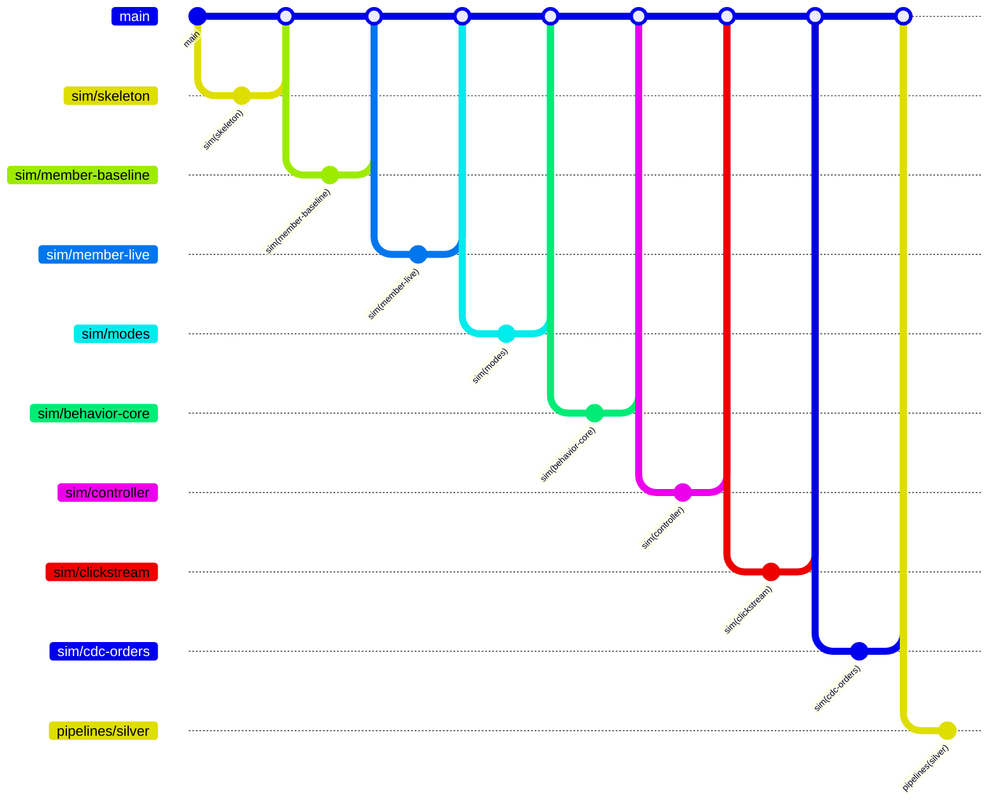

# 브랜치 지도

브랜치·커밋 규칙 본문은 루트 `CLAUDE.md`의 Git 절이다. 이 문서는 **영역 목록**과 **브랜치 대장**만 관리한다.
담당자는 이 문서에 적지 않는다(팀 역할표 기준).

## 1. 원칙

- **폴더 하나 = 영역 하나 = 브랜치 접두어 하나.** 자기 영역 폴더만 수정한다. 다른 영역이 필요하면 그 담당에게 요청하거나 `docs/contracts/`에 필요한 내용을 적는다.
- 공용 파일(`CLAUDE.md`, 이 문서, `.github/`)은 `docs/` 영역 브랜치로 따로 올린다.
- 새 기능은 **최신 `main` → 새 브랜치 → 작업 지시서 1개 → 대장에 한 줄 → PR** 순서로 한다.
- 머지하면 브랜치를 지우고, 대장의 상태를 "머지됨"으로 바꾼다.
- 머지 전에 작업 지시서(`docs/tasks/<영역>-<작업>.md`) 맨 아래 **`작업 결과`** 절을 채운다. 대장의 "작업 지시서" 링크를 열면 그 브랜치가 무엇을 했는지 읽을 수 있다. 브랜치 하나는 며칠 안에 머지한다.

## 2. 영역

| 영역(접두어) | 폴더 | 내용 | 상태 |
|---|---|---|---|
| `infra` | `infra/` | Terraform 스택, 모듈 | 사용 중 |
| `db` | `db/` | RDS 테이블 DDL | 사용 중 |
| `sim` | `simulator/` | 거래·회원 시뮬레이터 | 사용 중 |
| `docs` | `docs/` | 설계 문서, 작업 지시서, 이 문서 | 사용 중 |
| `conn` | `connectors/` | Debezium·Kafka 설정, Bronze 적재 | 시작 전 |
| `review-sim` | `review-simulator/` | 리뷰 시뮬레이터 | 시작 전 |
| `review-model` | `review-analysis/` | 리뷰 분석 모델 학습 | 시작 전 |
| `silver` | `pipelines/silver/` | Bronze → Silver Spark 잡 | 시작 전 |
| `gold-a` | `pipelines/gold_a/` | Gold A(대시보드용) 잡 | 시작 전 |
| `gold-b` | `pipelines/gold_b/` | Gold B(관제용) 잡 | 시작 전 |
| `agent` | `agent/` | 탐지 규칙, 이상 이력, 조사 에이전트, 승인 | 시작 전 |
| `ci` | `.github/` | GitHub Actions | 시작 전 |
| `api` | `api/` | 업무 API(WAS, FastAPI). 시뮬레이터 → API → RDS·Kafka(clickstream). 설계: `docs/design/api.md` | 시작 전 |

새 영역이 필요하면 **이 표에 한 줄을 추가하는 `docs/` PR**을 먼저 올린다. 접두어는 소문자와 `-`만 쓴다.

## 3. 브랜치 구조도

구조도는 아래 대장의 "머지됨"과 "진행 중" 행을 그대로 옮겨 그린다. 대장을 먼저 고치고 구조도를 맞춘다.

## 4. 브랜치 대장

영역별 구역으로 나눈다. **자기 영역 구역만 수정**한다(다른 사람과 같은 줄을 고치지 않기 위해서다).

### sim
| 브랜치 | 작업 지시서 | 상태 | 머지일 |
|---|---|---|---|
| `sim/skeleton` | `docs/tasks/sim-skeleton.md` | 머지됨 | 2026-10-13 |
| `sim/member-baseline` | `docs/tasks/sim-member-baseline.md` | 머지됨 | 2026-10-13 |
| `sim/member-live` | `docs/tasks/sim-member-live.md` | 머지됨 | 2026-10-14 |
| `sim/modes` | `docs/tasks/sim-modes.md` | 머지됨 | |
| `sim/behavior-core` | `docs/tasks/sim-behavior-core.md` | 머지됨 | |
| `sim/controller` | `docs/tasks/sim-controller.md` | 머지됨 | |
| `sim/clickstream` | `docs/tasks/sim-clickstream.md` | 머지됨 | |
| `sim/cdc-orders` | `docs/tasks/sim-cdc-orders.md` | 머지됨 | |

### docs
| 브랜치 | 작업 지시서 | 상태 | 머지일 |
|---|---|---|---|
| `docs/branch-rules` | - | 진행 중 | |
| `docs/api-design` | - (설계 문서 `docs/design/api.md`) | 진행 중 | |
| `docs/data-contracts` | [docs-data-contracts.md](tasks/docs-data-contracts.md) | 검토 대기 | |

### infra
| 브랜치 | 작업 지시서 | 상태 | 머지일 |
|---|---|---|---|
| `infra/ready` | [infra-ready.md](tasks/infra-ready.md) | 머지됨 (PR #11) | 2026-10-16 |
| `infra/rds-first` | [infra-rds-first.md](tasks/infra-rds-first.md) | 머지됨 (infra/ready에 통합) | 2026-10-16 |
| `infra/deploy-result` | [infra-deploy-result.md](tasks/infra-deploy-result.md) | 머지됨 | 2026-10-16 |
| `infra/pipeline-smoke` | [infra-pipeline-smoke.md](tasks/infra-pipeline-smoke.md) | 검토 대기 | |
| `infra/ecs-review-simulator` | [sim-review-ecs.md](tasks/sim-review-ecs.md) (리뷰 시뮬레이터 ECS 기반) | 진행 중 | |

### 그 밖의 영역
`db`, `conn`, `review-sim`, `review-model`, `gold-a`, `gold-b`, `agent`, `ci`는 이 문서 도입 후 첫 브랜치를 만들 때 자기 영역 구역(`### <영역>`)을 이 아래에 추가한다.

### pipelines
| 브랜치 | 작업 지시서 | 상태 | 머지일 |
|---|---|---|---|
| `pipelines/silver` | [silver-pipelines.md](tasks/silver-pipelines.md) | 검토 대기 | |
