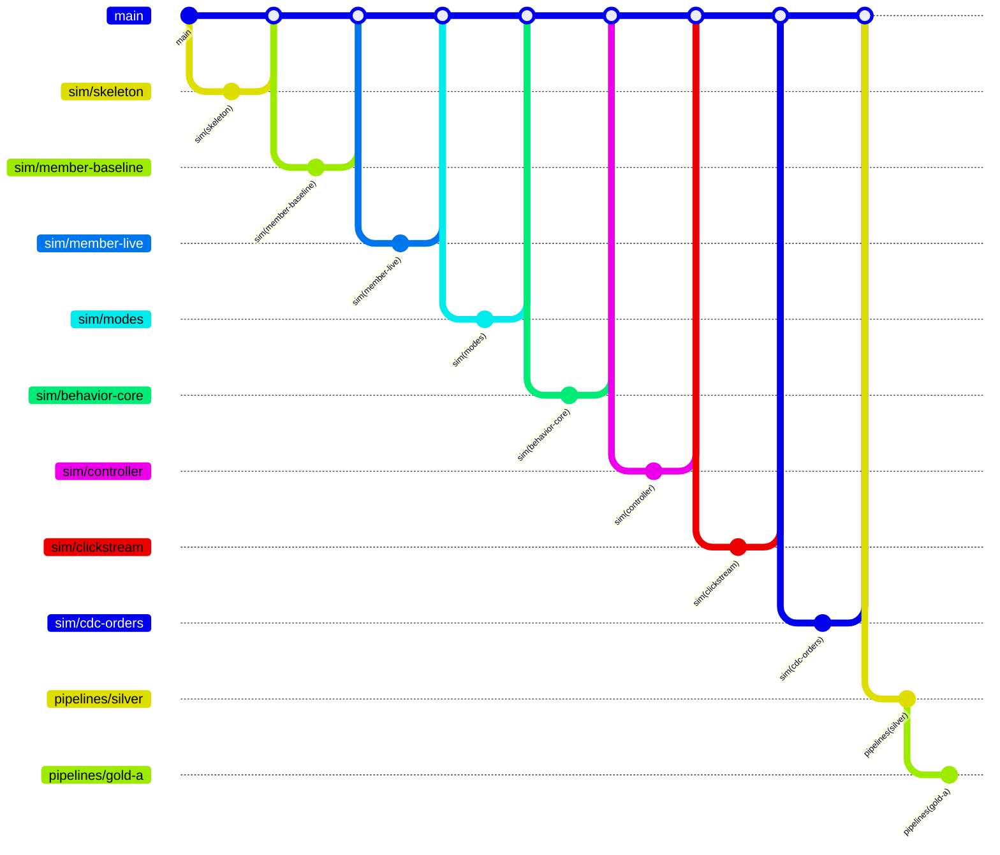

# 브랜치 지도

브랜치·커밋 규칙 본문은 루트 `CLAUDE.md`의 Git 절이다. 이 문서는 **영역 목록**과 **브랜치 대장**만 관리한다.
담당자는 이 문서에 적지 않는다(팀 역할표 기준).

## 1. 원칙

- **폴더 하나 = 영역 하나 = 브랜치 접두어 하나.** 자기 영역 폴더만 수정한다. 다른 영역이 필요하면 그 담당에게 요청하거나 `docs/contracts/`에 필요한 내용을 적는다.
- 공용 파일(`CLAUDE.md`, 이 문서, `.github/`)은 `docs/` 영역 브랜치로 따로 올린다.
- 새 기능은 **최신 `main` → 새 브랜치 → 작업 지시서 1개 → 대장에 한 줄 → PR** 순서로 한다.
- 머지하면 브랜치를 지우고, 대장의 상태를 "머지됨"으로 바꾼다.
- 머지 전에 작업 지시서(`docs/tasks/<영역>-<작업>.md`) 맨 아래 **`작업 결과`** 절을 채운다. 대장의 "작업 지시서" 링크를 열면 그 브랜치가 무엇을 했는지 읽을 수 있다. 브랜치 하나는 며칠 안에 머지한다.

## 2. 영역

| 영역(접두어) | 폴더 | 내용 | 상태 |
|---|---|---|---|
| `infra` | `infra/` | Terraform 스택, 모듈 | 사용 중 |
| `db` | `db/` | RDS 테이블 DDL | 사용 중 |
| `sim` | `simulator/` | 거래·회원 시뮬레이터 | 사용 중 |
| `docs` | `docs/` | 설계 문서, 작업 지시서, 이 문서 | 사용 중 |
| `conn` | `connectors/` | Debezium·Kafka 설정, Bronze 적재 | 시작 전 |
| `review-sim` | `review-simulator/` | 리뷰 시뮬레이터 | 시작 전 |
| `review-model` | `review-analysis/` | 리뷰 분석 모델 학습 | 시작 전 |
| `silver` | `pipelines/silver/` | Bronze → Silver Spark 잡 | 시작 전 |
| `gold-a` | `pipelines/gold_a/` | Gold A(대시보드용) 잡 | 시작 전 |
| `gold-b` | `pipelines/gold_b/` | Gold B(관제용) 잡 | 시작 전 |
| `dashboard` | `dashboard/` | 대시보드 앱(Streamlit, 상품 관리·데이터 관리 Role). 배포 소스는 `infra/platform/dashboard/`(infra 영역) | 사용 중 |
| `agent` | `agent/` | 탐지 규칙, 이상 이력, 조사 에이전트, 승인 | 시작 전 |
| `agent` | `agent/` | 탐지 규칙, 이상 이력, 조사 에이전트, 승인 | 사용 중 |
| `ci` | `.github/` | GitHub Actions | 시작 전 |
| `api` | `api/` | 업무 API(WAS, FastAPI). 시뮬레이터 → API → RDS·Kafka(clickstream). 설계: `docs/design/api.md` | 시작 전 |

새 영역이 필요하면 **이 표에 한 줄을 추가하는 `docs/` PR**을 먼저 올린다. 접두어는 소문자와 `-`만 쓴다.

## 3. 브랜치 구조도

구조도는 아래 대장의 "머지됨"과 "진행 중" 행을 그대로 옮겨 그린다. 대장을 먼저 고치고 구조도를 맞춘다.

## 4. 브랜치 대장

영역별 구역으로 나눈다. **자기 영역 구역만 수정**한다(다른 사람과 같은 줄을 고치지 않기 위해서다).

### sim
| 브랜치 | 작업 지시서 | 상태 | 머지일 |
|---|---|---|---|
| `sim/skeleton` | `docs/tasks/sim-skeleton.md` | 머지됨 | 2026-10-13 |
| `sim/member-baseline` | `docs/tasks/sim-member-baseline.md` | 머지됨 | 2026-10-13 |
| `sim/member-live` | `docs/tasks/sim-member-live.md` | 머지됨 | 2026-10-14 |
| `sim/modes` | `docs/tasks/sim-modes.md` | 머지됨 | |
| `sim/behavior-core` | `docs/tasks/sim-behavior-core.md` | 머지됨 | |
| `sim/controller` | `docs/tasks/sim-controller.md` | 머지됨 | |
| `sim/clickstream` | `docs/tasks/sim-clickstream.md` | 머지됨 | |
| `sim/cdc-orders` | `docs/tasks/sim-cdc-orders.md` | 머지됨 | |
| `sim/ecs-image` | `docs/tasks/sim-ecs-image.md` | 머지됨 | 2026-10-22 |
| `sim/normal-scale` | `docs/tasks/sim-normal-scale.md` | 진행 중 | |
| `sim/sink-pause` | [sim-sink-pause.md](tasks/sim-sink-pause.md) | 진행 중 | |
| `sim/review-delivered` | [sim-review-delivered.md](tasks/sim-review-delivered.md) (리뷰 시뮬레이터 배송완료 기준·KST 0시 실행) | 검토 대기 | |
| `sim/normal-scale` | `docs/tasks/sim-normal-scale.md` | 머지됨 | 2026-10-22 (#60) |
| `sim/console` | `docs/tasks/sim-console.md` | 머지됨 | |

### docs
| 브랜치 | 작업 지시서 | 상태 | 머지일 |
|---|---|---|---|
| `docs/branch-rules` | - | 머지됨 (PR #5) | 2026-10-16 |
| `docs/api-design` | - (설계 문서 `docs/design/api.md`) | 진행 중 | |
| `docs/data-contracts` | [docs-data-contracts.md](tasks/docs-data-contracts.md) | 검토 대기 | |
| `docs/agent-anomaly-design` | [anomaly-answer-key.md](design/agent/anomaly-answer-key.md) (설계 문서) | 머지됨 (PR #28) | 2026-10-21 |
| `docs/agent-branches` | - | 머지됨 (PR #43) | 2026-10-21 |
| `docs/agent-ledger` | - | 진행 중 | |

### infra
| 브랜치 | 작업 지시서 | 상태 | 머지일 |
|---|---|---|---|
| `infra/eks-audit-cost` | [infra-eks-audit-cost.md](tasks/infra-eks-audit-cost.md) | PR #39 머지됨·수집 중단 취소 후속 | 2026-10-21 |
| `infra/eks-audit-restore` | [infra-eks-audit-restore.md](tasks/infra-eks-audit-restore.md) | 실제 복구 완료·검토 대기 | |
| `infra/kafka-retention-only` | [infra-kafka-retention-week.md](tasks/infra-kafka-retention-week.md) | Kafka 7일 보관·alias 충돌 수정만 최신 main에서 분리, 실환경 적용 이력 포함 | |
| `infra/shared-deployment-config` | [infra-shared-deployment-config.md](tasks/infra-shared-deployment-config.md) | 최신 main 통합·머지 전 검증 | |
| `infra/agent-development-access` | [infra-agent-development-access.md](tasks/infra-agent-development-access.md) | 실제 적용·PR #49 검토 대기 | |
| `infra/airflow-runtime` | [infra-airflow-runtime.md](tasks/infra-airflow-runtime.md) | 개발 Airflow 설치·합성 검증 완료, PR #41 검토 대기 | |
| `infra/gold-b-access-prep` | [infra-gold-b-access-prep.md](tasks/infra-gold-b-access-prep.md) | 조회 기반 적용·실제 Pod 접근 검증 완료 | |
| `infra/agent-data-write` | [infra-agent-data-write.md](tasks/infra-agent-data-write.md) | 실제 적용·PR #50 검토 대기 | |
| `infra/ready` | [infra-ready.md](tasks/infra-ready.md) | 머지됨 (PR #11) | 2026-10-16 |
| `infra/rds-first` | [infra-rds-first.md](tasks/infra-rds-first.md) | 머지됨 (infra/ready에 통합) | 2026-10-16 |
| `infra/deploy-result` | [infra-deploy-result.md](tasks/infra-deploy-result.md) | 머지됨 | 2026-10-16 |
| `infra/pipeline-smoke` | [infra-pipeline-smoke.md](tasks/infra-pipeline-smoke.md) | 검토 대기 | |
| `infra/generator-was-access` | [infra-generator-was-access.md](tasks/infra-generator-was-access.md) | 실제 연결 완료·검토 대기 | |
| `infra/ecs-review-simulator` | [sim-review-ecs.md](tasks/sim-review-ecs.md) (리뷰 시뮬레이터 ECS 기반) | 진행 중 | |
| `infra/review-order` | [infra-review-order.md](tasks/infra-review-order.md) (리뷰 시뮬레이터 RDS 주문 읽기) | 검토 대기 | |
| `infra/sagemaker-review-score` | [infra-sagemaker-review-score.md](tasks/infra-sagemaker-review-score.md) (리뷰 점수화 SageMaker Processing Job 기반) | 진행 중 | |
| `infra/sagemaker-model-release` | [dashboard-model-benchmark.md](tasks/dashboard-model-benchmark.md) (점수화 SSM 을 릴리스 묶음 기준으로. `dashboard/model-benchmark`에 머지해 함께 올림) | 진행 중 | |
| `infra/ecs-simulator` | [infra-ecs-simulator.md](tasks/infra-ecs-simulator.md) (거래·회원 시뮬레이터 ECS) | 머지됨 | 2026-10-22 |
| `infra/ecs-simulator-backend` | [infra-ecs-simulator-backend.md](tasks/infra-ecs-simulator-backend.md) (ECS 스택 backend 설정 공유) | 진행 중 | |
| `infra/spark-preparation-share` | [infra-spark-preparation-share.md](tasks/infra-spark-preparation-share.md) | 비활성 Spark 기반 통합 공유, 업무 명세·배포 대기 | |
| `infra/spark-runtime-prep` | [infra-spark-runtime-prep.md](tasks/infra-spark-runtime-prep.md) | 원본 보존, 합성 시험 완료·업무 미적용. spark-preparation-share로 공유 | |
| `infra/athena-review-score` | [infra-athena-review-score.md](tasks/infra-athena-review-score.md) (점수 결과 Iceberg 테이블 Athena/Glue 기반, 초안) | 진행 중 | |

### api
| 브랜치 | 작업 지시서 | 상태 | 머지일 |
|---|---|---|---|
| `api/mvp` | `docs/tasks/api-mvp.md` | 검토 대기 | |

### agent
| 브랜치 | 작업 지시서 | 상태 | 머지일 |
|---|---|---|---|
| `agent/detection-draft` | [agent-detection-draft.md](tasks/agent-detection-draft.md) | 머지됨 (PR #14) | 2026-10-21 |
| `agent/tools-draft` | [agent-tools-draft.md](tasks/agent-tools-draft.md) | 머지됨 (PR #30) | 2026-10-21 |
| `agent/detect-skeleton` | [agent-detect-skeleton.md](tasks/agent-detect-skeleton.md) | 머지됨 (PR #29) | 2026-10-21 |
| `agent/detect-athena` | [agent-detect-athena.md](tasks/agent-detect-athena.md) | 머지됨 (PR #46) | 2026-10-21 |
| `agent/skeleton` | [agent-skeleton.md](tasks/agent-skeleton.md) | 머지됨 (PR #42) | 2026-10-21 |
| `agent/review-fixes` | [agent-review-fixes.md](tasks/agent-review-fixes.md) | 머지됨 (PR #48) | 2026-10-21 |
| `agent/detect-r6` | [agent-detect-r6.md](tasks/agent-detect-r6.md) | 머지됨 (PR #47) | 2026-10-21 |
| `agent/eval-score` | [agent-eval-score.md](tasks/agent-eval-score.md) | 머지됨 (PR #96) | 2026-10-24 |

| `agent/ddl` | [agent-ddl.md](tasks/agent-ddl.md) | 머지됨 (PR #53) | 2026-10-22 |
| `agent/bedrock` | [agent-bedrock.md](tasks/agent-bedrock.md) | 머지됨 (PR #54) | 2026-10-23 |
| `agent/image-build` | [agent-image-build.md](tasks/agent-image-build.md) | 머지됨 (PR #62) | 2026-10-23 |
| `agent/dags` | [agent-dags.md](tasks/agent-dags.md) | 머지됨 (PR #64) | 2026-10-23 |
| `agent/approval` | [agent-approval.md](tasks/agent-approval.md) | 머지됨 (PR #66) | 2026-10-23 |
| `agent/followups` | [agent-followups.md](tasks/agent-followups.md) | 머지됨 (PR #71) | 2026-10-23 |
| `agent/folder-filter` | `agent-folder-filter.md` 없음(작은 변경, PR #72 본문 참고) | 머지됨 (PR #72) | 2026-10-23 |
| `agent/conclusion-check` | [agent-conclusion-check.md](tasks/agent-conclusion-check.md) | 머지됨 (PR #76) | 2026-10-23 |
| `agent/silver-source` | `agent-silver-source.md` 없음(작은 변경, PR #80 본문 참고) | 머지됨 (PR #80) | 2026-10-23 |
| `agent/rules-doc` | [agent-rules-doc.md](tasks/agent-rules-doc.md) | 검토 대기 | |
| `agent/silver-conf` | [agent-silver-conf.md](tasks/agent-silver-conf.md) | 머지됨 (PR #108) | 2026-10-24 |

### dashboard
| 브랜치 | 작업 지시서 | 상태 | 머지일 |
|---|---|---|---|
| `dashboard/gold-a-athena` | [dashboard-gold-a-athena.md](tasks/dashboard-gold-a-athena.md) (Gold A 완료 실행·보류 목록 Athena 조회 및 상품 관리 화면 연결) | 검토 대기 | |
| `dashboard/baseline` | [dashboard-baseline.md](tasks/dashboard-baseline.md) | 진행 중 | |
| `dashboard/deploy` | [dashboard-deploy.md](tasks/dashboard-deploy.md) (대시보드 EKS 배포 파일, ECR 스택, 공유 ALB 템플릿) | 진행 중 | |
| `dashboard/model-benchmark` | [dashboard-model-benchmark.md](tasks/dashboard-model-benchmark.md) (감성분석 모델 화면, 패치노트, 릴리스 묶음·되돌림, 점수화 SSM. `review-model/release`·`infra/sagemaker-model-release` 포함, 세 영역 통합 예외) | 진행 중 | |
| `dashboard/approval-page` | [dashboard-approval-page.md](tasks/dashboard-approval-page.md) | 검토 대기 | |

### 그 밖의 영역
`db`, `conn`, `review-sim`, `review-model`, `gold-a`, `gold-b`, `ci`는 이 문서 도입 후 첫 브랜치를 만들 때 자기 영역 구역(`### <영역>`)을 이 아래에 추가한다.

### conn
| 브랜치 | 작업 지시서 | 상태 | 머지일 |
|---|---|---|---|
| `conn/bronze-v2` | [conn-bronze-v2.md](tasks/conn-bronze-v2.md) | 머지됨 (infra 포함, 사용자 예외 승인) | |

### pipelines
| 브랜치 | 작업 지시서 | 상태 | 머지일 |
|---|---|---|---|
| `pipelines/silver` | [silver-pipelines.md](tasks/silver-pipelines.md) | 기본 구현 main 머지됨 (#26), 단가 기준은 #63 반영 | 2026-10-21 |
| `pipelines/payment-fingerprint` | [pipelines-payment-fingerprint.md](tasks/pipelines-payment-fingerprint.md) | 머지됨 (#55) | 2026-10-22 |
| `pipelines/r6-output` | [pipelines-r6-output.md](tasks/pipelines-r6-output.md) | 머지됨 (#45) | 2026-10-22 |
| `pipelines/format-rules-silver` | [pipelines-format-rules-silver.md](tasks/pipelines-format-rules-silver.md) | 머지됨 (#65) | 2026-10-22 |
| `pipelines/reconciliation` | [pipelines-reconciliation.md](tasks/pipelines-reconciliation.md) | 머지됨 (#35) | 2026-10-22 |
| `pipelines/format-rules-gold-b` | [pipelines-format-rules-gold-b.md](tasks/pipelines-format-rules-gold-b.md) | 머지됨 (#63) | 2026-10-22 |

### gold-b
| 브랜치 | 작업 지시서 | 상태 | 머지일 |
|---|---|---|---|
| `pipelines/gold-b` | [gold-b-pipelines.md](tasks/gold-b-pipelines.md) | 머지됨 (#36) | 2026-10-22 |
| `pipelines/gold-b-views` | [gold-b-views.md](tasks/gold-b-views.md) | 머지됨 (#70) | 2026-10-23 |
| `pipelines/gold-b-collector` | [gold-b-collector.md](tasks/gold-b-collector.md) | 머지됨 (#78) | 2026-10-23 |
| `pipelines/gold-b-reprocess` | [gold-b-reprocess.md](tasks/gold-b-reprocess.md) | 머지됨 (#84) | 2026-10-23 |
| `pipelines/gold-b-format-check` | [gold-b-format-check.md](tasks/gold-b-format-check.md) | 머지됨 (#91) | 2026-10-23 |
| `pipelines/gold-b-compact` | [gold-b-compact.md](tasks/gold-b-compact.md) | 머지됨 (#88) | 2026-10-23 |
| `pipelines/gold-b-ingest` | [gold-b-ingest.md](tasks/gold-b-ingest.md) | 머지됨 (#92) | 2026-10-23 |
| `pipelines/gold-b-payment-update` | [gold-b-payment-update.md](tasks/gold-b-payment-update.md) | 머지됨 (#95) | 2026-10-23 |
| `pipelines/gold-b-image` | [gold-b-image.md](tasks/gold-b-image.md) | 머지됨 (#98) | 2026-10-24 |
| `pipelines/gold-b-reprocess-by-message` | [gold-b-reprocess-by-message.md](tasks/gold-b-reprocess-by-message.md) | 머지됨 (#99) | 2026-10-24 |
| `pipelines/gold-b-dags` | [gold-b-dags.md](tasks/gold-b-dags.md) | 검토 대기 | |
| `pipelines/gold-b-bronze-reprocess` | [gold-b-bronze-reprocess.md](tasks/gold-b-bronze-reprocess.md) | 검토 대기 | |

### gold-a
| 브랜치 | 작업 지시서 | 상태 | 머지일 |
|---|---|---|---|
| `pipelines/gold-a` | [gold-a-metrics.md](tasks/gold-a-metrics.md) | main 동기화 완료·PR #67 검토 대기 (#34는 Silver에 머지) | |
