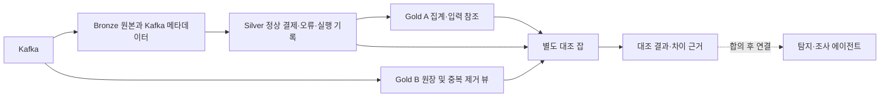

# Silver・Gold A・Gold B 공통 데이터 계약

상태: 제안 — 원천에서 확인한 규칙과 경로 간 합의할 규칙을 구분한다.

## 1. 이 문서와 YAML의 차이

| 파일 | 역할 |
|---|---|
| 이 문서 | 데이터의 의미, 계층별 역할, 중복・격리・재처리・대조 약속 |
| [format_rules.yaml](format_rules.yaml) | Silver가 읽는 원천 필수 컬럼・타입・허용 값・조건 검사와 별도 합의 대기 제안 |

두 파일을 하나의 공통 계약 작업으로 관리한다. YAML의 필드 목록을 이 문서에 다시 복사하지 않는다. 사용자 승인으로 `source_rules`를 공통 검사기 `pipelines/format_rules.py`와 거래 Silver에 연결했다. Gold B는 아직 연결하지 않았다. 로컬 기본 경로는 이 폴더의 format_rules.yaml이며 CLI --rules-path로 명시할 수 있다. 운영 배포 방식과 Gold B 연결은 공동 검토 대상이다.

YAML 전체 status=proposed는 경로 간 미합의 제안을 포함한다는 뜻이다. 실행하는 승인 규칙만 source_rules_status=decided, version=0.1.1로 구분한다. runtime_connected는 소비 경로별 상태(silver=true, gold_b=false)를 나타낸다. proposed_changes를 원천 검사에 자동으로 합치지 않는다.

현재 범위는 주문・주문상품・결제다. 회원・클릭・리뷰・AI 결과 계약은 이번 YAML에 추측해서 추가하지 않는다. Gold A 지표의 상세 정의는 Gold A 설계에서 관리하고, 여기에는 다른 경로와 맞출 접점만 남긴다.

## 2. 근거와 상태 읽는 법

| 표시 | 뜻 |
|---|---|
| 결정: 원천 확인 | 저장소의 DDL 또는 생산 코드에 명시된 규칙. 모든 소비 경로의 적용까지 확인했다는 뜻은 아님 |
| 제안 | 경로 간 적용 또는 새 동작에 대한 검토안 |
| 미정 | 실제 입력이나 실행 환경을 확인한 뒤 정할 사항 |

근거:

- [거래 DDL](../../db/schema/004_orders.sql): PK・FK・필수 컬럼・상태・시간 제약, 결제 INSERT 전용 설계 주석.
- [행동 시뮬레이터 설명](../../simulator/README.md#행동-behavior): 시뮬레이터 시각, 주문과 결제의 쓰기 방식.
- [DB 출력 코드](../../simulator/src/sim/behavior/sink.py): 주문 상태 UPDATE, 결제 INSERT.
- 사용자 제공 Gold B 설계의 「형식 검사」「정리 뷰 payment_attempts」「Silver・Gold A와 맞추기」: 공통 규칙, 결제 뷰, 재처리 연결 방향. 저장소에 해당 문서 원문이 있다고 가정하지 않는다.

원천 기준 커밋: `9bbc29f731949e6de7d6258d87d20bf9df2008d3`. 이후 원천 변경 시 이 문서와 YAML도 함께 검토한다.

## 3. 데이터의 의미

| 원천 | 한 행의 의미・고유 키 | 연결 키 | 변경 방식 |
|---|---|---|---|
| `orders` | 주문 1건, `order_id` | `member_id`, `session_id` | 같은 주문의 상태를 UPDATE |
| `order_items` | 주문 안의 상품 항목 1개, `order_item_id`. 수량은 여러 개일 수 있음 | `order_id`, `article_id` | 현재 코드에 INSERT 경로가 있음. 향후 수정・삭제 허용 여부는 별도 확인 |
| `payments` | 결제 시도 1번, `payment_id` | `order_id`, `attempt_no` | 결과 확정 후 INSERT만. 기존 시도는 수정하지 않음 |

결제 재시도는 같은 주문에 새 `payment_id`와 다른 `attempt_no`를 가진 새 행이다. `(order_id, attempt_no)`는 원천에서 UNIQUE다. PK 자체가 UPDATE를 금지하는 것은 아니며, INSERT 전용은 생산 계약이다.

## 4. 계층별 결과와 책임

| 계층 | 결과・처리 | 목적 |
|---|---|---|
| Silver | `orders_current`, `order_status_history`, `silver_order_items`, `payment_attempts` | 현재 상태・이력・분석 상세 제공 |
| Gold A | `order_sales_hourly`, `product_sales_daily` 등 | Silver를 입력으로 비즈니스 집계 |
| Gold B | `payment_events` 원장 → `payment_attempts` 정리 뷰, 메시지・오류・지연 기록 | 시스템 탐지・조사에 필요한 사실 제공 |

Gold B 원장과 Silver 결과의 행 수를 그대로 같게 맞추지 않는다. Gold B 원장은 재수신을 보존하고, 정리 뷰에서 결제 중복을 제거한다. 문서에서는 `Silver payment_attempts`와 `gold_b.payment_attempts`를 구분해서 쓴다. Silver의 실제 카탈로그 이름은 여기서 확정하지 않는다.

`amount`는 Gold A 승인 금액 계산을 위해 Silver에 필요하다. Gold B 원장에 같은 컬럼을 반드시 추가할 필요는 없다. Gold B의 PG 실패 기록과 Gold A 승인 금액은 영향 조사에서 함께 보며, 숫자가 동일해야 하는 지표는 아니다.

## 5. Gold B에 제안하는 결제 처리 계약

원천에 이미 정의된 키・필수값・허용값은 3절과 YAML의 `source_rules`를 참조한다. 아래에는 Gold B의 출력 보존과 소비 처리에 대해 확인・합의할 내용만 적는다.

`☐`는 수용 확인 전, `☑`는 Gold B 담당자와 수용 합의 완료를 뜻한다. 합의 후 해당 칸을 바꾼다. 수용 체크는 구현・검증 완료를 의미하지 않는다.

| 항목 | Gold B 제안 내용 | 필요한 이유 | Gold B 수용 |
|---|---|---|---|
| 주문 연결 | 결제 원장과 정리 뷰에 `order_id`를 필수로 보존한다. | 실패한 주문의 재시도 성공 여부・영향 주문 수・영향 상품을 조사하기 위해 필요. PG별 실패율 계산 자체에는 필수 아님. | ☐ |
| 결제 시도 번호 보존 | 결제 원장과 정리 뷰에 `attempt_no`를 보존한다. | 같은 주문에서 실패 후 몇 번째 시도에 성공했는지 확인. PG별 실패율 계산 자체에는 필수 아님. | ☐ |
| 동일 내용 재수신 | 원장은 수신 기록을 보존하고, 정리 뷰에서는 동일 `payment_id`의 같은 업무 내용을 결제 시도 1건으로 처리한다. | 재수신 때문에 결제 시도 수와 실패율이 달라지지 않도록 함. | ☐ |
| 내용 충돌 | 같은 `payment_id`의 업무 내용이 다르면 단순 중복으로 버리거나 임의의 한 행을 정답으로 고르지 않고 충돌로 기록한다. 비교 컬럼・정상 집계 포함 여부를 함께 합의한다. | 어느 기록이 맞는지 판단할 수 없는 결제를 정상으로 확정하지 않도록 함. | ☐ |
| 형식 오류 처리 | 원천 형식 규칙을 위반한 결제는 정상 결제 집계에서 제외하고 오류 기록으로 남긴다. | Silver와 Gold B가 같은 잘못된 기록을 서로 다르게 집계하지 않도록 함. | ☐ |
| 모르는 실패 코드 | 비어 있지 않은 미등록 코드는 소비 경로에서 결제 기록에 포함하고 Gold B에서 `UNKNOWN`으로 분류하는 안을 검토한다. | 실패 사실과 원인 분류 불가를 구분. 현재 원천 DDL의 허용 목록과는 별도 합의가 필요함. | ☐ |

`attempt_no >= 1`은 **최솟값 규칙**이다. 같은 주문의 첫 결제 시도는 1이고, 이후 시도는 2, 3처럼 센다. 이 조건은 재시도 횟수의 상한을 정하지 않는다. 상한은 시뮬레이터 생성 정책에서 관리한다.

### Gold B에 `order_id` 보존을 요청하는 이유

PG별 결제 시도 실패율만 계산할 때는 `order_id`가 필수는 아니다. 보존을 요청하는 목적은 Gold B에서 발견한 PG 장애를 Silver의 주문・결제 상세와 연결해 사업 영향을 조사하는 것이다.

| 조사할 질문 | `order_id`의 용도 |
|---|---|
| 실패한 결제가 재시도 후 결국 성공했나? | 서로 다른 `payment_id`를 같은 주문으로 묶어 실패・성공 기록 확인 |
| 실패 시도 여러 건이 몇 개 주문에 해당하나? | 실패 시도 수와 중복 제외한 영향 주문 수 구분 |
| 어떤 상품이 영향을 받았나? | Silver 주문상품의 `order_id`와 연결해 `article_id` 확인 |

예를 들어 P1이 실패하고 P2가 성공했을 때 두 기록의 `order_id`가 O1이면, 같은 주문이 재시도 후 성공한 것으로 연결할 수 있다. `attempt_no`는 그 주문 안에서 몇 번째 시도인지 확인하는 값이다.

Gold A의 시간별 승인 금액・성공 주문 수는 같은 기간의 사업 영향을 보는 데 사용하고, 개별 주문의 재시도 과정은 Silver 또는 Gold B 결제 상세에서 확인한다. `order_id` 보존만으로 장애가 매출 감소의 원인임을 증명하는 것은 아니다. Gold B 원장・뷰의 보존 요청은 위 표의 수용 체크로 합의 여부를 관리한다.

### 원천 규칙과 UNKNOWN 제안을 섞지 않기

현재 DDL은 실패 코드를 5개로 제한한다. 따라서 모르는 실패 코드는 현 DDL의 정상 INSERT 경로에서는 허용되지 않는다. 새 정상 코드의 도입이나 비정상 Kafka 입력을 고려한 UNKNOWN 허용은 별도 소비 계약이다.

**현재 적용 기준: 원천 DDL의 5개 코드.** Silver의 코드 존재 여부 검사만으로 미등록 코드가 통과하던 차이를 수정하는 기준이다. 실패 코드 누락과 미등록은 서로 다른 오류로 기록하며, 미등록 코드도 현재는 정상 결제 결과에 포함하지 않는다. 합의 전 제안을 기본 동작으로 사용하지 않는다. Gold B의 실제 적용은 담당자 확인 대상이다.

| 입력 | 현재 원천/YAML・Silver 기준 | 미등록 허용안이 합의된 이후의 제안 |
|---|---|---|
| FAILED + 허용 코드 5개 중 하나 | 정상 실패 결제로 포함 | 동일 |
| FAILED + 코드 없음・빈 문자열・공백 | MISSING_FIELD로 오류 기록 | 동일. UNKNOWN으로 채우지 않음 |
| FAILED + 문자열이 아닌 코드 | TYPE_MISMATCH로 오류 기록 | 동일 |
| FAILED + 비어 있지 않은 미등록 문자열 | INVALID_VALUE로 오류 기록 | 원래 failure_code를 보존해 실패 결제로 포함하고 Gold B 원인 분류만 UNKNOWN |
| SUCCESS + failure_code=NULL | 정상 성공 결제로 포함 | 동일 |
| SUCCESS + 실패 코드 값 있음 | INVALID_VALUE로 오류 기록 | 동일 |

**미등록 코드 허용 제안의 이유:** PG가 새 코드를 도입했을 때 실제 실패가 집계에서 빠져 실패율이 낮아지는 일을 방지하려는 확장안이다. 오타・비정상 데이터까지 정상으로 포함할 위험도 있으므로 Gold B 담당자와 승인 범위・관제 방법을 합의해야 한다. UNKNOWN은 별도 분류 결과이며 원본 failure_code를 UNKNOWN으로 덮어쓰는 안이 아니다. 현재 Silver에 이 허용 동작이나 UNKNOWN 자동 분류를 구현하지 않는다.

YAML의 `source_rules`는 현재 DDL을 충실히 옮긴 기준이다. `proposed_changes`의 UNKNOWN 허용안을 합의하기 전에는 소비 검사 기준으로 자동 적용하지 않는다. 향후 허용한다면 실패 코드의 열거 제한을 변경하고, 분류표에 없는 비어 있지 않은 코드를 통과시키도록 같은 버전으로 반영해야 한다. UNKNOWN은 분류 규칙이며 분류 실행은 Gold B 뷰의 책임이다.

현재 Silver는 YAML source_rules의 허용 목록을 실제로 읽는다. Gold B 연결과 UNKNOWN 분류는 미적용이다. 이번 수정으로 원천 DB 허용값을 변경하지 않는다. 이전의 runtime_connected=false 단일 값은 경로별 연결 상태로 대체했다.

### 내용 충돌

비교 후보는 `order_id`, `attempt_no`, `method`, `pg`, `amount`, `status`, `failure_code`, `requested_at`, `completed_at`이다. 양쪽이 비교할 공통 컬럼과 원본 단계 검사 여부는 합의한다. `loaded_at`과 Kafka 위치는 재수신마다 달라질 수 있으므로 업무 내용 충돌 기준으로 쓰지 않는다.

충돌 기록 시 원문 전체 대신 결제 키・원본 위치・충돌 필드명을 우선 남긴다. 모든 충돌 후보와 이전 반영 기록을 다시 찾을 수 있도록 원본 참조를 보존한다. 임의로 첫 행 또는 최신 행을 정답으로 확정하지 않는다. Gold A의 갱신 보류・복구는 8절의 제안을 따른다. Silver・Gold B 정상 행의 포함・제외 및 격리 해제에 대한 공동 합의는 별도다. 여러 행을 비교하는 검사는 YAML의 단일 행 형식 검사와 별도다.

## 6. 주문・주문상품 처리 계약

### 결제 내용 지문 규약 — payment-content.v1

**상태: 사용자 승인으로 공통 함수와 Silver 호출·저장까지 로컬 구현. Gold B 호출·적재·정리 뷰 연결은 후속 작업.** 입력 규칙과 별도 규약이며 format_rules.yaml에 지문 설정을 추가하지 않는다.

| 항목 | v1 기준 |
|---|---|
| 내용 필드 순서 | order_id, attempt_no, method, pg, amount, status, failure_code, requested_at, completed_at |
| 식별·제외 정보 | payment_id는 비교 키로 별도 유지. Kafka 위치·시각, CDC 정보, loaded_at 등 전달 정보는 지문 제외 |
| 정수 | attempt_no/amount는 1 이상 Python 정수. bool·문자열·실수 변환 없음 |
| 문자열 | 비어 있지 않은 문자열, trim/대소문자/유니코드 정규화 없음. 허용값 정책은 공통 입력 검사에서 적용 |
| NULL | SUCCESS의 failure_code는 명시적 None과 필드 생략을 JSON null로 통일한다(기존 YAML 검사와 일치). FAILED의 누락/None/빈 문자열/공백은 오류. 나머지 8개 필드는 필수이며 임의 보충 없음 |
| 시각 입력 | 시간대 포함 ISO 문자열: YYYY-MM-DDTHH:MM:SS[.1~6자리](Z 또는 ±HH:MM). datetime 객체·시간대 없는 값·7자리 이상 소수초는 거부 |
| 시각 정규화 | UTC, 소수초 6자리, Z 고정. 반올림·절삭 없음 |
| 직렬화 | 고정 순서 JSON 배열, ensure_ascii=False, 공백 없는 separators, UTF-8, NaN 금지 |
| 알고리즘·반환 | SHA-256 소문자 64자리 payment_content_hash, fingerprint_version=payment-content.v1 |

공통 구현은 [pipelines/payment_fingerprint.py](../../pipelines/payment_fingerprint.py)다. 공개 함수 payment_fingerprint(payment)는 위 두 필드의 dict를 반환한다. canonical_payment_content(payment)는 명세 확인용 UTF-8 바이트를 반환하며 내용을 로그·원장에 통째로 쓰지 않는다. 원본 dict는 수정하지 않는다. FingerprintError는 실패한 field만 전달한다.

```python
from pipelines.payment_fingerprint import payment_fingerprint

# 호출 경로가 업무 입력 검사를 통과시킨 원천 행을 전달한다.
# 시각 문자열은 datetime/Spark TIMESTAMP 등으로 바꾸기 전 값이어야 한다.
# 이후 이 두 필드를 각 경로의 결과/원장에 보존하는 연결은 후속이다.
fingerprint = payment_fingerprint(validated_payment)
```

양쪽 호출 순서는 원천 JSON 파싱 → 공통 업무 입력 검사 → 원천 시각 문자열 그대로 지문 계산 → Silver UTC/KST 출력 또는 Gold B TIMESTAMP 변환·저장이다. 업무 입력 검사기가 시각을 내부적으로 파싱하더라도 원천 문자열은 보존해야 한다. 기존 입력 검사는 7자리 이상 소수초를 허용할 수 있으므로 지문 함수가 정밀도를 확인하기 전에 datetime/Spark 변환을 하면 안 된다. Silver의 requested_at_utc/completed_at_utc를 재매핑하는 방식은 원천 정밀도 손실을 감출 수 있어 이 규약에서는 사용하지 않는다. 함수는 필드 별칭을 자동 추측하지 않는다. 기존 KST 출력·집계는 유지한다.

입력 정책과 지문 규칙은 분리한다. 이 함수가 미등록 실패 코드 문자열의 지문을 만들 수 있어도 그 코드를 정상 입력으로 수용한다는 뜻은 아니다. FormatRules의 허용 목록·조건 검사는 먼저 적용해야 한다. method/pg의 enum, UUID 형식, 완료>=요청 등 정책을 지문 모듈에 중복 정의하지 않는다. 공통 YAML/DDL은 이번 작업에서 변경하지 않는다.

지문은 동일 payment_id의 내용 비교에 사용한다. 같은 버전의 다른 해시는 충돌 근거이며, 같은 해시만으로 원본 범위 완료/누락 없음을 증명하지 않는다. fingerprint_version이 다르면 지문 불일치를 곧바로 내용 충돌로 확정하지 않고 비교 불가로 두거나 같은 버전으로 원본에서 재계산한다. 필드/정규화/직렬화/알고리즘 변경은 지문 버전을 올리고 이전 기록의 전환 절차를 합의한다. 입력 허용값만 바뀌면 지문 버전을 반드시 바꿀 필요는 없다.

공통 코드의 고정 벡터:

```text
["o-1",1,"CARD","PG_A",20000,"SUCCESS",null,"2026-10-21T06:00:00.000000Z","2026-10-21T06:00:02.123000Z"]
SHA-256: efad032726ae5d4a0ab003e0e99175c4a372076e9d5e26a5c5d7a2b0235979fa
```

Gold B 원장은 두 컬럼 보존 정의를 반영했지만 실제 호출/원장 적재/뷰 동작 완료를 뜻하지 않는다. Silver는 입력 검사 후 원본 시각 문자열로 지문을 계산하고, 같은 payment_id의 지문·버전으로 중복·충돌을 비교하며 정상 결과에 두 컬럼을 저장한다. 지문 입력 오류는 INVALID_VALUE로 격리한다. 현재 비교 범위는 이번 실행에 제공한 입력이며, 과거 실행의 모든 동일 ID와 자동 비교하지 않는다. 기존 동일 ID 후보·지문 버전 혼재·원본 재계산·해시만으로 변경 필드를 알 수 없는 경우의 원본 추적은 후속 연결에서 검토한다.

### 주문·주문상품 기준

| 대상 | 처리 기준 | 상태・근거 |
|---|---|---|
| 주문 상태 | 허용 상태와 `status_reason` 조건은 YAML의 원천 규칙 참조 | 결정: DDL |
| 현재 상태 | 같은 `order_id`의 변경을 정렬해 최신 상태 1행 생성 | Silver 설계. 실제 CDC 순서 정보 연결은 미정 |
| 상태 이력 | 상태가 바뀐 기록 보존. 재수신 때문에 이력 증가하지 않도록 처리 | 제안: 실제 변경 식별 정보 확인 필요 |
| `updated_at` | 예정된 시뮬레이터 상태 변경 시각. 실제 적재・DB 갱신 시각으로 해석하지 않음 | 결정: DDL・시뮬레이터 문서 |
| 같은 변경 시각 충돌 | CDC 변경 순서와 원본 위치를 확인한 뒤 해결 기준 결정 | 미정 |
| 주문상품 중복 | 동일 `order_item_id`의 동일 내용 재수신은 판매량을 늘리지 않음 | 제안 |
| 상품 금액 | `quantity × unit_price` | Gold A 계산 기준안 |
| 주문 생성 수 | `ordered_at` KST 시간대에 주문당 1회 | Gold A 기준안 |
| 결제 성공・승인 금액 | 성공 결제의 `completed_at` 기준. 현재 주문 상태가 PAID인 행만 고르지 않음 | Gold A 기준안 |

주문상품 unit_price는 2026-10-21 사용자 승인으로 5,900원 이상을 적용한다. DB DDL의 unit_price > 0보다 엄격한 공통 업무 검사 기준이다. 근거는 상품 가격 하한 팀 결정([상품 작업 명세](../tasks/sim-product-seed.md)), PRICE_MIN=5_900([상품 설정](../../simulator/src/sim/product/params.py)), Gold B의 주문상품 하한 및 이번 사용자 승인이다. 주문 시 단가는 product_variant.price에서 복사한다. 기존 상품 검증은 design_price를 검사하므로 이것만으로 모든 주문 단가가 이미 보장된다고 간주하지 않는다. version 0.1.0의 minimum: 1을 0.1.1에서 5900으로 변경했다. quantity·amount·total_amount의 기존 최솟값과 미등록 실패 코드 제안은 이번에 변경하지 않는다. 취소・환불 차감과 순매출은 Gold A 지표 설계에서 따로 결정한다.

## 7. 공통 검사 연결

YAML은 CDC 봉투를 해석하고 원천 타입을 정규화한 뒤의 업무 행을 대상으로 한다. 실제 Kafka 값이 `after` 봉투인지 펼친 필드인지, timestamp가 어떤 직렬화 형태인지는 원본으로 확인한다.

- 같은 규칙 버전과 동일한 필드명 매핑을 적용한다. 필드명이 바뀌면 단순 허용 목록 변경 외에 표준 필드로 변환하는 매핑도 필요하다.
- 봉투 해석과 이벤트 채택을 구분한다. 결제는 INSERT 전용이지만 주문・회원의 UPDATE를 공통 모듈에서 일괄 제거하지 않는다.
- 데이터셋 키 `order_items`는 원천 이름이다. Kafka 토픽 `order-items`와 실제 Bronze 경로 매핑은 별도 입력 설정이다.
- 오류 사유는 PARSE_ERROR / MISSING_FIELD / TYPE_MISMATCH / INVALID_VALUE로 맞추는 제안이다. 내용 충돌은 단일 행 형식 오류와 별도로 기록한다.
- 정수는 bool이나 소수로 대체하지 않는다. timestamp는 시간대가 있는 시각으로 해석하고, UTC와 KST를 서로 다른 순간으로 저장하지 않는다.

필드 검사 조건의 세부 목록은 YAML에서 관리하고, 변경 시 버전과 source_rules_status를 함께 검토한다. 이 문서에는 동일 목록을 중복 유지하지 않는다. 자체 규칙 형식이며 범용 검증 도구의 표준 스키마가 아니다. 중복 키・알 수 없는 규칙/타입/조건・잘못된 참조・적용 미승인 상태는 실행 실패로 처리하며 기본값으로 통과시키지 않는다.

### Silver 실행 연결

- 거래 업무 필드 검사는 UUID・문자열・정수(bool 제외)・시간대 포함 시각・허용값・최솟값 및 YAML 조건 7개를 실행한다. CDC 봉투 처리・변경 순서・중복・여러 행의 금액 검사는 기존 Silver 코드에 남긴다.
- 데이터 오류는 MISSING_FIELD/TYPE_MISMATCH/INVALID_VALUE와 rule_id를 기존 격리 기록에 남긴다. YAML 파일 누락/문법/정의 오류는 실행을 중단하고 이전 결과를 보존한다.
- YAML을 실행 시작에 한 번 읽고 파일 내용의 SHA-256・version・경로・적용 범위・소비 경로를 dq_results와 current.json의 format_rules에 기록한다. 실행 중 파일이 바뀌어도 읽어 둔 같은 규칙으로 해당 실행을 마친다.
- 실행 의존성은 pipelines/requirements.txt의 PyYAML이다. 테스트만을 위한 느슨한 UUID/PG 허용 모드는 제공하지 않는다. 정상 예시는 원천 형식과 같은 UUID 및 허용값을 사용한다.

## 8. 재처리・검증・대조

| 내용 | 계약 방향 | 상태 |
|---|---|---|
| 원본 | Kafka・Bronze를 읽어서 다시 계산. 원본을 직접 수정하지 않음 | 공통 방향 |
| 규칙 수정 | 수정한 버전・대상 범위・영향 경로를 확인하고 승인 | 제안: 실행 연결 필요 |
| Gold B | 문서상 이벤트 시간 폴더 단위 원장 교체 후 재판정 | Gold B 설계. 배포 완료를 뜻하지 않음 |
| Silver가 이미 처리한 범위 | Silver 재실행 → 영향받은 Gold A 재집계 | 공통 연결 제안 |
| Silver 미처리 범위 | 다음 배치가 실제 그 원본을 읽는 경우만 다음 실행에 맡김 | 처리 범위 확인 필요 |
| 반복 실행 | 같은 입력・규칙이면 업무 결과가 같고 중복 증가 없음 | 공통 요구 |
| 처리 기록 | 실행 식별값, 입력 범위, 사용 규칙 버전, 성공 여부, 정상・격리 건수, 출력 위치 | 제안. 저장 형식 미정 |
| 최초 경로 대조 | 같은 원본 범위・규칙 버전에서 Silver와 Gold B 결제 뷰의 payment_id 및 공통 업무 값을 비교 | 제안 |
| 상시 대조 | 주기・담당・실패 대응을 별도 결정 | 미정. Gold A 실행마다 필수라고 가정하지 않음 |

입력 범위는 최대 timestamp 하나만으로 확정하지 않는다. 파일과 Kafka 파티션별 읽은 위치를 어떤 형식으로 남기는지 Bronze 담당과 확인한다. 데이터 부족・처리 중 상태를 실제 누락으로 오판하지 않는다. 외래 키 검사는 입력 도착 순서도 고려하므로 단일 행 YAML 검사만으로 수행하지 않는다.

재처리와 상시 적재・파일 합치기가 같은 출력 범위를 동시에 쓰지 않게 하는 방법, 오류 원본의 S3 보존, 여러 폴더 중 일부 실패 시 상태, 에이전트의 Gold A・Silver 조회 권한은 별도 실행 설계에서 확인한다.

### 결제 경로 대조 잡 초안 (2026-10-21)

**상태: 제안.** 아래는 Silver/Gold B 담당자 공동 검토용이다. 승인된 로컬 구현은 거래 Silver의 선택적 Kafka 원본 참조 보존뿐이다. 실제 A/B 대조 잡·Gold B 어댑터·Airflow 실행·알림은 아직 연결하지 않았다.

#### 목적과 구조

업무 장애 조사와 처리 누락 검증을 구분한다. PG 장애 시 매출 비교는 completed_at/ordered_at과 업무 키를 사용한다. 아래 잡은 같은 결제 원본을 두 경로가 빠짐없이 같은 기준으로 처리했는지 확인한다. Gold A와 Gold B 전체 집계 숫자를 같게 만드는 작업이 아니다.



대조 잡이 Gold B를 조회하는 것이며 Gold A의 집계 입력을 Gold B로 바꾸지 않는다. AI가 원본 일치 여부를 판정하지 않고 키·값·처리 범위를 결정적인 코드로 비교한다.

#### 비교할 내용

| 단계 | 비교 대상 | 기준·예외 |
|---|---|---|
| 입력 준비 | 두 경로의 원천 토픽·파티션별 범위, 원천/소비 규칙 버전, 읽은 실행 묶음 | 같은 완료 범위를 고정한 뒤 비교. 최대 시각 또는 offset 최솟값/최댓값만 같다고 준비 완료로 보지 않음 |
| 포함 여부 | Silver payment_attempts ↔ Gold B 중복 제거 뷰의 payment_id 집합 | 원장은 재수신을 포함할 수 있어 원장 행 수를 직접 비교하지 않음 |
| 업무 값 | 같은 payment_id의 order_id·attempt_no·status·amount·pg·method·failure_code·requested_at·completed_at | 시각은 같은 순간으로 정규화하고 금액은 정수로 비교. UNKNOWN 원인 분류는 원본 failure_code를 대체하지 않음 |
| 제외 이유 | 정상 출력에서 빠진 키 ↔ 각 경로의 오류·격리·충돌·연결 대기 기록 | 정상 99건+격리 1건을 정상 100건과 같다고 판정하지 않음. 제외 근거까지 보고 정책 차이/업무 차이 구분 |
| Gold A 자체 검증 | 사용한 Silver 성공 결제 → 시간별 고유 성공 order_id 수·amount 합계 ↔ Gold A paid_order_count·approved_amount | completed_at KST 구간. order_count는 ordered_at 기준이므로 성공 결제 수와 비교하지 않음. PARTIAL 보류 범위는 비교 불가로 표시 |

Gold B 뷰가 최신 결과만 담고 있어 과거 원천 범위로 고정할 수 없다면, 먼저 범위 고정 스냅샷/추적 참조가 필요하다. 업무 시각만 필터링해 같은 원본을 읽었다고 간주하지 않는다. 비교 컬럼이 없으면 임의로 NULL/0으로 채우지 않는다.

#### 실행과 결과 제안

- Gold A 공개 완료를 실행 신호로 삼는 안이다. 상시 의무 실행 주기와 재시도 횟수는 은서·인프라 담당자와 합의한다. 대조 때문에 Gold B 조기 탐지를 기다리게 하지 않는다.
- 두 경로 중 한쪽이 해당 원천 범위까지 아직 읽지 않았다는 근거가 있으면 WAITING_INPUT, 범위/컬럼/규칙 호환 여부를 확인할 수 없으면 NOT_COMPARABLE이다. 불일치로 단정하지 않는다.
- 공통 범위와 규칙을 확인한 뒤 차이가 있으면 MISMATCH, 모든 비교가 통과하면 MATCH다. 범위 없음/양쪽 빈 결과만으로 MATCH를 만들지 않는다.
- 결과 기록 제안: comparison_run_id, 비교 계약 버전, 양쪽 실행 ID/manifest/규칙 버전, 토픽별 범위 증거, 대상 KST 구간, 상태, missing/extra/conflicting 키 건수, 차이 원본 참조, 보류 이유, 실행 시각. 원문·회원 속성은 복사하지 않는다.
- 대조 오류를 곧바로 원천 수정·자동 재처리로 연결하지 않는다. 입수 대기/규칙 차이/계산 오류를 조사하고 기존 승인 절차로 처리한다.

#### Bronze → Silver 원본 추적 입력 초안

| Bronze JSON 행 필드 제안 | 타입·의미 |
|---|---|
| kafka_topic | 비어 있지 않은 문자열 |
| kafka_partition | 0 이상 정수 |
| kafka_offset | 0 이상 정수. 파티션 내부 위치 |
| kafka_timestamp | 시간대 포함 ISO 시각. source_ts_ms나 completed_at과 다름 |
| kafka_timestamp_type | CreateTime 또는 LogAppendTime. 무조건 브로커 도착 시각으로 해석하지 않음 |

성철과 실제 필드명·시간 표현을 합의해야 한다. Sink 설정은 이번 변경에서 수정하지 않는다. 거래 Silver는 위 필드가 있을 때 검사된 값만 `_input_source.kafka`로 보존하며 정상/오류 후보는 impact_candidates의 source로, 격리 행은 kafka_reference로 연결한다. 원문 필드를 원본 참조에 통째로 복사하지 않는다.

거래 current.json의 kafka_observations에 입력 데이터셋별 VALID/INVALID/MISSING 건수와 토픽·파티션별 min_offset/max_offset/row_count/unique_offset_count를 남긴다. coverage_status는 항상 UNVERIFIED이며 관측만으로 연속성·처리 완료·대조 일치를 보장하지 않는다. 파일명 시작 offset+줄 번호로 위치를 추정하지 않는다. 메타데이터 누락/오류는 업무 행을 격리하는 새 규칙이 아니고 추적 제한으로 기록한다. 대조 잡은 이 경우 실제 근거 없이 MATCH를 만들 수 없다.

#### 담당자별 PR 확인표

체크는 담당자가 확인할 항목이며 현재 동의·구현 완료를 뜻하지 않는다. 확인일 기준 #20/#26은 main 머지, #34는 pipelines/silver로 머지된 상태다. #34의 main 반영은 별도 확인이 필요하다.

| 대상 | 담당·관련 PR | 무엇을 확인할지 |
|---|---|---|
| ☐ 원본 보존 | 성철: [#32 CDC/Sink](https://github.com/josiah113366-sketch/clothes-query/pull/32), connectors/bronze-s3-sink.yaml | Kafka 행별 위치·시각 보존 방식, timestamp 유형, 실제 샘플. 경로 날짜 설정만으로 각 행 정보가 보존되는 것은 아님 |
| ☐ 공통 기준 | 현지·은서: [#20 계약](https://github.com/josiah113366-sketch/clothes-query/pull/20) | 비교 필드·오류 제외·미등록 코드 정책과 적용 버전. 문서 머지가 모든 제안 수용은 아님 |
| ☐ Silver 추적 | 현지: [#26 Silver](https://github.com/josiah113366-sketch/clothes-query/pull/26) 및 이번 후속 로컬 변경 | current.json → impact_candidates/격리 → Bronze 파일·줄·Kafka 참조 연결. 후속 변경은 기존 #26에 포함됐다고 보지 않음 |
| ☐ Gold B 입력 | 은서: [#36 원장 정의](https://github.com/josiah113366-sketch/clothes-query/pull/36), main 머지됨 | DDL·샘플만 반영됐다. 정리 뷰의 해시·버전 출력·격리 조회·과거 범위 고정·실행 기록은 후속 구현에서 확인 |
| ☐ Gold A 기준 | 현지: [#34 Gold A](https://github.com/josiah113366-sketch/clothes-query/pull/34) | inputs의 Silver 실행 참조, KST 계산·PARTIAL/held_scopes 처리. Gold A 결과와 같은 Silver 묶음으로 기대값 계산 |
| ☐ 탐지 결과 연결 | 주현: [#28 이상 이력](https://github.com/josiah113366-sketch/clothes-query/pull/28), [#29 판정 잡](https://github.com/josiah113366-sketch/clothes-query/pull/29) | 대조 상태를 어떻게 기록·알림할지. WAITING/NOT_COMPARABLE을 업무 장애로 오탐하지 않기 |
| ☐ 조사 조회 | 주현: [#30 조사 도구](https://github.com/josiah113366-sketch/clothes-query/pull/30) | 실행·차이·오류 참조 조회와 접근 권한. 도구가 이미 연결됐다고 가정하지 않음 |
| ☐ 운영 연결 | 인프라 담당, 관련 PR은 연결 계획 승인 후 지정 | Gold A 완료 후 실행 신호·실행 잠금·재시도·결과 저장·권한·복구 절차 |

#### 구현 순서와 현재 경계

1. 이번 로컬 구현: 선택적 Kafka 메타데이터 검증·원본 참조 보존·관측 범위 기록. 기존 파일·줄 및 메타데이터 없는 입력 호환 유지.
2. 성철/은서 합의 후: 실제 Bronze 필드 연결과 Gold B 조회 어댑터·완료 범위 증거 구현.
3. 별도 작은 대조 잡: 공통 범위 고정 → 결제 키/값/오류 비교 → Gold A 자체 계산 검증 → 상태·차이 저장. 실행 파일은 계약 확정 후 별도 브리핑한다.
4. 실제 같은 입력 범위로 검증 후: DAG·판정/조사 도구 연결. 누락/충돌/입수 대기/정상 0건 사례를 확인한다.

### 오류 영향 범위와 갱신 보류 (기존 설계)

**상태: 경로 간 계약은 제안, 로컬 Gold A 구현은 PR #34에서 검토 중.** Gold A의 명시적 scope-aware 실행은 영향 범위를 추적할 수 있는 결제 오류에 대해 범위별 갱신 보류를 지원한다. 주문·주문상품 오류 또는 추적 불가능한 오류는 관련 거래·퍼널 묶음 전체를 보류한다. 기본 엄격 실행은 품질 오류 시 갱신을 중단한다. 단일 행 형식 검사 YAML에는 넣지 않는다.

| 항목 | 처리 규칙 제안 |
|---|---|
| 영향 범위 | 충돌한 모든 원본 후보와 이전 집계에 반영한 기록의 주문 키・시각・상품・세션을 따라 범위의 합집합을 찾는다. 정상 Silver 출력만으로 판단하지 않는다. |
| 정상 범위 갱신 | 원본 읽기 범위와 필요한 참조 데이터의 완전성이 확인된 범위만 새 결과로 교체한다. 오류가 발견되지 않았다는 사실만으로 완전하다고 판단하지 않는다. |
| 영향 범위 보류 | 문제 기록만 빼고 계산한 부분 합계를 정상 결과로 공개하지 않는다. 영향을 받는 집계 키 단위의 갱신을 보류한다. |
| 이전 결과 제공 | 마지막 정상 결과를 유지하되 갱신 보류・오류 이유・마지막 정상 갱신 시각을 함께 제공한다. 이전 결과가 없으면 결과 없음으로 표시하며 0건・0원으로 대체하지 않는다. |
| 범위 추적 불가 | 키・시각・참조 정보를 복원하지 못하면 관련 집계 작업의 요청 범위 전체를 보류한다. 독립적인 리뷰 작업까지 일괄 중단하지 않는다. |
| 기록의 책임 | Silver는 원본 오류와 추적 참조를 기록한다. Gold A는 그 오류 때문에 최신 입력을 반영하지 못한 집계 범위를 기록한다. |
| 보류 기록 위치 | 별도 목록 파일을 신설하기보다 기존 Gold A manifest에 대상 테이블・범위・이유・오류 참조・마지막 정상 결과 참조를 기록하는 안으로 시작한다. 정확한 필드 구조는 구현 계획에서 정한다. |
| 복구 | 올바른 입력 또는 처리 규칙을 확정한 뒤 Silver 재처리 → 영향받은 Gold A 범위 전체 재계산 → 검증 → 결과 교체와 보류 해제 순서로 수행한다. 기존 금액에 차액을 단순 추가하지 않는다. |

정상 범위의 새 결과, 보류 범위의 이전 결과, 범위별 보류 상태를 같은 공개 묶음으로 제공한다. 일부가 보류됐는데 전체가 최신 PASS인 것처럼 표시하지 않는다. 반복 실행 시 미해결 보류와 기존에 잘못 반영한 범위의 복구 대상을 유지한다. 결과 공개에 실패하면 이전 공개 묶음을 보존하고 실패 실행을 기록한다. 동시에 같은 범위를 변경하지 않도록 하는 실행 제어는 구현 시 함께 정한다.

재처리는 수정 후 해당 범위를 명시해 실행할 수 있도록 하며, 다음 정기 배치를 기다리는 방식으로 한정하지 않는다. 자동 실행 연결과 복구 소요 시간 보장은 아직 없으며 실제 데이터로 측정한다. Gold A별 영향 범위 기준과 현재 부분 교체 기능의 제한은 Gold A README에서 관리한다.

## 9. 다음 합의와 적용 순서

### 리뷰 분석 날짜 계약 — KST 작성일 (2026-10-22 결정)

비즈니스 분석 날짜는 리뷰 created_at의 Asia/Seoul 날짜로 통일한다. SageMaker 실행일·결과 생성일·emitted_at 날짜로 리뷰 집계일을 바꾸지 않는다. 아래 계약은 리뷰 실행 연결용이며 거래 format_rules.yaml에 리뷰 규칙을 추가하는 변경은 아니다.

| 구간 | 날짜 기준과 처리 |
|---|---|
| Bronze 리뷰 원본 | 시뮬레이터 LakeSink가 created_at의 UTC 날짜로 year/month/day 폴더에 보관 |
| Silver 리뷰 | normalize_review에서 created_at_utc·created_at_kst·review_date_kst 생성. 출력 year/month/day는 KST 작성일 |
| SageMaker 입력 선택 | Silver의 지정 KST 작성일 범위에 속한 리뷰 ID·본문을 사용. 이미 KST인 값에 9시간을 다시 더하지 않음 |
| SageMaker 결과 | review_id/aspect/score. 현재 점수화 코드는 날짜 변환·작성일 파티셔닝을 하지 않고 작업 이름별 출력 위치에 저장 |
| Gold A 리뷰 집계 | review_id로 해당 Silver 리뷰와 연결해 review_date_kst로 별점·속성 점수 집계. 모델 분석이 다음 날 끝나도 원래 작성일에 반영 |

예: 2026-10-22T00:30:00+09:00은 UTC 2026-10-21T15:30:00Z와 같은 순간이다. Bronze에서는 UTC 21일 폴더, Silver·Gold A에서는 KST 22일에 속한다. KST 하루 D는 UTC D-1일 15:00 이상~D일 15:00 미만이며, Silver는 D-1·D의 UTC 폴더를 읽은 뒤 KST 날짜로 필터링한다. 날짜 범위 끝은 작성일 기준 포함이나 실제 시각 구간 끝은 제외한다.

입력 시각은 Z 또는 +09:00 등 시간대가 명시되어야 한다. Silver는 시간대 없는 시각을 거부하며 원천 시간대를 임의로 추정하지 않는다. 이미 KST인 입력도 astimezone 변환이므로 중복으로 9시간을 더하지 않는다.

후속 DAG/모델 입력 생성기는 모델 작업과 Silver 고정 실행 참조·대상 KST 시작/종료일·리뷰 ID 목록/건수·모델 버전을 연결할 기록을 남겨야 한다. Airflow의 UTC logical_date/ds나 SageMaker 작업 이름에 있는 날짜를 리뷰 작성일로 대신 쓰지 않는다. 필요한 날짜는 Asia/Seoul로 명시적으로 산정한다. 모델 입력 생성·작업 실행·완료 확인·입력 범위 기록의 자동 연결은 아직 구현 완료가 아니다.

### 공통 계약 후속 적용

1. Gold B의 `order_id` 필수화, 실패 코드 누락과 UNKNOWN 처리, 내용 충돌 기록에 대한 반영 확인.
2. 규칙 파일 형식・최종 위치・버전 배포와 검사 코드 분담 확정.
3. 실제 주문 CDC・Bronze 샘플로 입력 변환과 원본 추적 필드 확인.
4. Silver・Gold B를 같은 버전으로 연결하고, 같은 범위로 최초 결과 비교.
5. 처리 범위 기록을 기준으로 Silver → Gold A 재처리 연결과 복구 검증 구체화.

공통 검사기와 거래 Silver 연결까지 로컬 구현했다. Gold B 연결・DAG・자동 대조・운영 배포는 별도다. 공통 계약의 경로 간 제안을 모두 합의 또는 구현한 것으로 표시하지 않는다.
