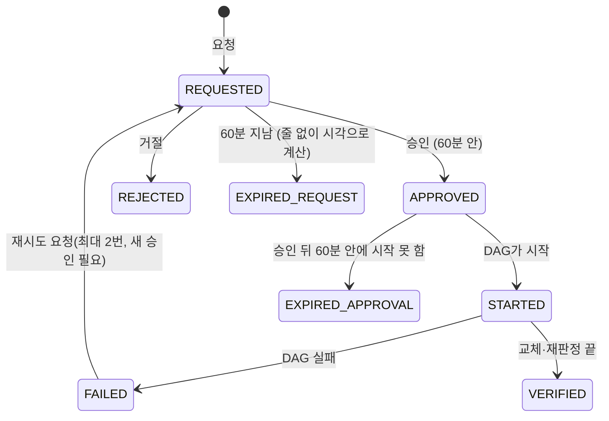

# 재처리 승인 흐름과 백엔드 규칙 (제안)

> 상태: 제안 · 코드: `agent/approval/` · 작성: 2026-10-22 · 팀 확정이 필요한 값은 9절에 모았다

## 1. 한 줄 요약

조사 리포트를 본 사람이 **재처리를 요청하고, 승인하면 Airflow DAG가 시작**된다. 인프라는 `reprocess_events`에 쓸 수 있는지까지만 막을 수 있어서(IAM이 줄의 `step`까지는 못 봄), **어떤 단계를 쓸 수 있는지, 누가 승인했는지, 중복 승인은 없는지**는 이 문서의 규칙을 구현한 백엔드(`agent/approval/approval.py`)가 막는다.

## 2. 누가 무엇을 쓰고 읽나

| 단계(step) | 쓰는 쪽 | 시점 |
|---|---|---|
| `REQUESTED` | 승인 백엔드(`request_reprocess`) | 사람이 화면에서 "재처리 요청" |
| `APPROVED` / `REJECTED` | 승인 백엔드(`approve` / `reject`) | 사람이 화면에서 승인·거절 |
| `STARTED`, `LEDGER_REPLACED`(폴더마다), `FAILED` | 재처리 DAG(은서·현지 님) | DAG 실행 중 |
| `REDETECTED`, `VERIFIED` | 판정 잡 | 교체가 끝난 뒤 5분 판정 |

읽는 쪽: 대시보드는 요청별 **마지막 줄(시각, 단계 순서)** 을 현재 상태로 본다. Athena 읽기·쓰기 권한은 인프라 담당이 준비했다(대시보드 전용 workgroup, 쓰기는 `gold_b/reprocess_events/`만).

## 3. 상태 흐름

## 4. 규칙 (구현: `agent/approval/approval.py`)

| # | 규칙 | 이유 |
|---|---|---|
| 1 | **승인자는 로그인한 사용자 이메일**이다. 화면 입력값, 개발용 로그인(`dev-user`), 이메일이 아닌 값은 거부한다. 승인자는 `actor`와 `detail.approved_by`에 남긴다 | 누가 눌렀는지 추적. IAM으로는 못 막음 |
| 2 | 허용 전이는 `REQUESTED → APPROVED/REJECTED`뿐이다. 다른 상태에서는 승인·거절할 수 없다 | 잘못된 줄 방지 |
| 3 | **요청 후 60분 안에 승인**해야 하고, **승인 후 60분 안에 시작**돼야 한다. 넘으면 새로 요청한다 | 조사 근거(조회 시점 데이터)가 낡는 것을 막음(60분은 제안값) |
| 4 | **중복 승인 3중 방지**: ① 쓰기 전에 현재 상태를 읽어 `REQUESTED`일 때만 `APPROVED`를 쓴다 ② 이미 `APPROVED`면 줄을 다시 쓰지 않고 호출만 재시도한다 ③ Airflow `dag_run_id`를 `request_id`로 하므로 두 번 부르면 **409**로 막힌다(성공 취급, `POLLER` 규칙은 호출이 없으므로 DAG가 막아야 함). Athena는 고유키가 없어서 동시에 두 사람이 눌러 `APPROVED`가 두 줄 생겨도 DAG는 한 번만 돈다 | Athena에는 유일 제약이 없음 |
| 5 | **같은 이상에 진행 중인 요청이 있으면 새 요청을 거절**한다(최근 6시간, 만료·거절·실패한 요청은 제외) | 같은 구간을 두 번 재처리하는 것을 막음 |
| 6 | 재시도는 **최대 2번**이다(시도 번호 `attempt` 1~3). 재시도도 **새 `request_id`, `parent_request_id` 연결, 새 승인**이 필요하다 | 은서 님 동의(2번), 새 승인은 제안 |
| 7 | 승인하면 **`APPROVED` 줄을 먼저 쓰고 그 뒤 Airflow를 부른다.** 줄 쓰기가 실패하면 호출하지 않는다. 호출이 실패하면 오류를 보여 주고 `APPROVED`는 남기며, **같은 승인으로 다시 시도**할 수 있다(`dag_run_id`가 같아 안전) | 호출 실패가 승인 기록을 지우면 안 됨 |
| 8 | `request_id`, `dag_id`, `anomaly_id`는 `[A-Za-z0-9._:+-]`만 허용한다 | 쿼리·API 경로 주입 방지 |
| 9 | 규칙(`rule_id`)마다 호출할 DAG를 정한다(6절). **DAG ID가 정해지지 않은 규칙은 요청을 거절**한다. `R3`(Bronze 지연)는 재처리가 값을 바꾸지 않아 대상이 아니다 | 아직 없는 DAG를 부르지 않음 |

## 5. 요청 줄(`reprocess_events`) 형식

| 컬럼 | REQUESTED | APPROVED / REJECTED |
|---|---|---|
| `request_id` | `rq-<UTC 시각>-<무작위 6자>` | 같은 값 |
| `at` | 요청 시각(UTC) | 그 줄을 쓴 시각 |
| `actor` | 요청한 사람 이메일 | 승인·거절한 사람 이메일 |
| `reason` | 비움 | 거절 사유(선택) |
| `window_start`, `window_end` | 이상의 시간대. **Gold B 원장(`KAFKA`)은 1시간 폴더 단위라 정시로 넓힘**, Silver는 그대로 | 같은 값 |
| `rule_version` | 공통 형식 검사 규칙 버전(현재 `0.1.0`) | 같은 값 |
| `source` | `KAFKA` 또는 `SILVER` | 같은 값 |
| `attempt`, `parent_request_id` | 1(재시도는 +1), 재시도 때 이전 요청 | 같은 값 |
| `detail`(JSON) | `anomaly_id`, `report_id`, `rule_id`, `dag_id`, (R6) `order_ids`(최대 500) | 위에 `approved_by` 추가 |

## 6. 규칙 → 재처리 DAG

| 규칙 | 호출할 DAG | source | 상태 |
|---|---|---|---|
| `R6_ORDER_TOTAL_MISMATCH` | `silver_gold_a_reprocess` | `SILVER` | 현지 님 제안(확정 아님) |
| `R1_PG_FAILURES`, `R4_MALFORMED`, `R5_DUPLICATE_SUCCESS` | **호출하지 않음(`POLLER`)**: 은서 님 워크플로우의 `gold_b_reprocess` DAG가 **5분마다 `APPROVED` 줄을 읽어** 시작한다 | `KAFKA` | 은서 님 워크플로우 그림 기준. **같은 `APPROVED` 줄을 두 번 처리하지 않는 것(`STARTED` 줄 확인)은 그 DAG의 몫이라 은서 님 확인 필요** |
| `R3_BRONZE_LAG` | 없음 | - | 재처리 대상 아님 |

`POLLER` 규칙은 승인하면 `APPROVED` 줄만 쓰고 Airflow를 부르지 않는다(최대 5분 뒤 DAG가 시작). 은서 님이 직접 호출 방식으로 바꾸면 `dag_by_rule`에 DAG ID만 넣으면 된다.

**경고 두 가지를 요청할 때 돌려준다**(`warnings`): `OUTSIDE_KAFKA_RETENTION`(구간이 Kafka 보관 3일을 넘음, 은서 님 워크플로우 "Kafka 보관 3일 안 우선"), 그리고 아래 경고.

**재처리로 해결되지 않을 수 있는 규칙(`R5`, `R6`)은 요청할 때 경고를 돌려준다**(`UNFIXABLE_BY_REPROCESS`). 데이터 오염은 원본 DB에 있는 행이라 재처리를 해도 다시 나오고, 재판정이 `STILL_OPEN`이 되기 때문이다(현지 님도 "재처리를 실행해도 원본 금액을 자동으로 고치지 않는다"고 적었다). 화면은 이 경고와 조사 리포트의 권고("재처리가 도움이 될지")를 같이 보여 준다.

## 7. Airflow 호출 계약 (Airflow 3.3.2)

1. `POST {AIRFLOW}/auth/token`, 본문 `{"username", "password"}` → `access_token`
2. `POST {AIRFLOW}/api/v2/dags/{dag_id}/dagRuns`, `Authorization: Bearer <token>`, 본문 `{"logical_date": null, "dag_run_id": "<request_id>", "conf": {...}}`
3. 응답: `200/201` 시작됨, `409` 같은 `dag_run_id`가 이미 있음(중복 호출, 성공 취급), 그 밖은 실패(승인은 남고 재시도 가능)

주소는 클러스터 내부 `http://airflow-api-server.airflow.svc.cluster.local:8080`이다(ALB 없음). 접속 정보는 Secret에서 읽는다(코드에 넣지 않는다).

`conf` 필드: `request_id`, `window_start`, `window_end`(시간대, 시작 포함·끝 미포함), `rule_version`, `source`, `anomaly_id`, `report_id`, `attempt`, (R6만) `order_ids`. `input_manifest`는 호출자가 아니라 **재처리 DAG의 첫 작업이 만든다**(현지 님과 합의 방향).

## 8. 재처리 DAG가 돌려줘야 할 것

DAG는 판정을 직접 부르지 않는다. **진행 상황을 `reprocess_events`에 남기고**(`STARTED`, 끝났을 때 교체 완료, 실패 시 `FAILED`) 판정 잡이 읽어 재판정한다(Gold B 설계). Silver 재처리의 완료 줄은 `LEDGER_REPLACED`에 `source='SILVER'`, `detail`에 `status`, `silver_run_id`, `actual_scope`, `held_scopes`, `failure_reason`을 넣는 안을 제안한다(은서·현지 님 확인 필요).

## 9. 확정이 필요한 것

| 항목 | 현재 값 | 누가 |
|---|---|---|
| 승인 유효 시간 | 60분(제안) | 팀(공지 이의 기한 10/23 12시) |
| 재시도 새 승인 필요 여부 | 필요(제안) | 팀 |
| Gold B 재처리는 5분 poller 방식으로 유지하는지(그림에는 poller), 같은 `APPROVED`를 두 번 처리하지 않는지 | poller(그림 기준) | 은서 님 |
| `silver_gold_a_reprocess` 확정, Silver 완료 줄 형식 | 제안 | 현지 님 |
| Airflow 접속 Secret의 키 이름 | 모름 | 재영 님 |
| 승인 화면 코드(`dashboard/`), 대시보드 이미지에 `agent/approval` 포함 | 없음 | 민혁 님과 |

## 10. 한계

- 진짜 Athena·Airflow로 돌려 보지 않았다(가짜 표·가짜 Airflow 시험만).
- 승인 버튼을 누를 수 있는 사람은 대시보드 `data` Role 전체다. 승인자를 한 명으로 제한하려면 허용 이메일 목록을 추가해야 한다(지금은 하지 않음).
