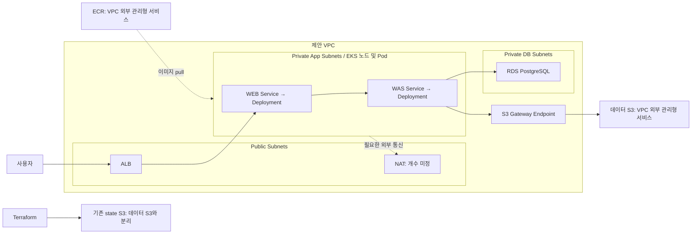

# 목표 아키텍처

상태: 제안 · 확정된 물리 구성 또는 배포 완료도가 아님

## 결정과 미정

**결정:** 이번 범위는 VPC·EKS·WEB·WAS·RDS·데이터 S3와 필수 연결 요소다. 현재 저장소의 도쿄 리전과 PostgreSQL 설계를 우선 보존한다. EKS와 Kubernetes/Helm 리소스의 state는 분리한다.

**제안:** 실습의 public/app/db subnet 분리 패턴을 활용하고 WEB/WAS는 별도 Deployment·Service로 둔다. public ALB → WEB → WAS → PostgreSQL/S3를 1차 검증 경로로 삼는다.

**미정:** 기존 AWS와 state, CIDR, AZ, NAT 수, 노드 방식/수/타입, Kubernetes 버전, RDS 버전/사양/Multi-AZ, 서비스 도메인/TLS, 앱 코드 소유자. 예제 수치를 자동 채택하지 않는다.

EKS 제어 영역은 AWS 관리 영역이며 위 EKS 박스는 VPC 내 노드/Pod를 뜻한다. Gateway Endpoint는 app route table과 연결하고 정책을 제한한다. S3 Gateway Endpoint 이용에는 추가 endpoint 요금이 없다. [AWS S3 Gateway Endpoint 문서](https://docs.aws.amazon.com/vpc/latest/privatelink/vpc-endpoints-s3.html)

## 통신·권한 계약 제안

| 경로 | 설정 및 검증할 조건 |
|---|---|
| 사용자 → ALB | 도메인/인증서/HTTPS 또는 제한된 임시 데모 공개 범위 결정 |
| ALB → WEB | 예제 포트 80, /health. Service/target type/health check가 실제 앱과 일치 |
| WEB → WAS | 예제 nginx `/api/` → `was-service:8000`; 동일 namespace 또는 명시적 DNS |
| WAS → RDS | PostgreSQL 5432, private DB, 실제 노드/Pod SG에서만 인바운드 허용. 전체 VPC CIDR로 넓히지 않음 |
| WAS → S3 | ServiceAccount 전용 IAM. 테스트/업무 prefix의 필요한 Get/Put/List만 허용. endpoint policy도 함께 확인 |
| Pod → AWS 자격증명 | Pod Identity 또는 IRSA 중 선택. 노드 역할에 앱의 S3 권한을 몰아주지 않음 |
| 노드 → ECR/외부 | NAT 또는 ECR API/DKR 등 필요한 interface endpoint 조합 선택. S3 endpoint만으로 전체 외부 통신이 해결되지 않음 |
| 관리자 → EKS API | 제한된 CIDR 또는 사설 접근 경로, access entry 및 RBAC |

Secrets Manager/SSM 기반 비밀 공급과 Kubernetes Secret 참조를 연결할 담당자를 정한다. master 계정을 앱에 주지 않고 최소 권한 DB 계정을 사용한다. ConfigMap에는 비밀 없는 값만 둔다. 계정 ID/실제 endpoint는 공개 저장소 규칙에 따라 비공개 설정 경로로 전달한다.

## EKS 선택

Auto Mode를 선택하면 실습 `eks.tf`와 `eks.amazonaws.com/alb` IngressClass를 함께 조정한다. Managed Node Group을 선택하면 그 방식의 add-on과 AWS Load Balancer Controller를 별도로 준비한다. 동일 ALB를 Terraform `aws_lb`와 Ingress 양쪽에서 관리하지 않는다. Auto Mode의 ALB 설정 API는 AWS 공식 문서와 일치하는지 구현 시 다시 확인한다. [Auto Mode ALB](https://docs.aws.amazon.com/eks/latest/userguide/auto-configure-alb.html), [Load Balancer Controller 방식](https://docs.aws.amazon.com/eks/latest/userguide/alb-ingress.html)

## 기존 스택 관례를 따르는 의존성 제안

`bootstrap → network → eks`는 보존한다. `platform`은 기존 설명대로 Kafka/Spark/Airflow 후속 스택으로 남긴다. RDS, 데이터 S3, ECR, 앱 배포 스택의 정확한 이름/경계는 팀과 결정한다.

| 역할 | 주요 입력 | 출력/다음 소비자 |
|---|---|---|
| network | region, CIDR, AZ, egress 방식 | VPC, app/db subnet, route table → eks/RDS |
| eks | app subnet, 관리자 접근, 노드 방식 | cluster 및 실제 workload SG → RDS 연결 규칙/앱 배포 |
| RDS | DB subnet, 허용 SG, DB 사양 | 비공개 접속 설정·Secret 참조 → WAS |
| 데이터 S3 | 이름, 보존 정책 | 버킷/prefix 권한 범위 → WAS 역할 |
| ECR | 이미지 소유권·보존 정책 | 이미지 저장소 → 빌드/배포 |
| 앱 배포 | cluster, 이미지 digest, 설정·Secret·IAM | WEB/WAS/Ingress 및 연결 검증 |

S3/ECR 자체는 VPC에 종속되지 않는다. RDS 인바운드가 EKS SG를 참조하는 제안이라면 eks가 먼저 준비되어야 한다. 스택 간 전달은 기존 규칙의 remote state 또는 SSM을 사용하고 양방향 의존을 피한다. backend key는 기존 `clothes-query/dev/<스택명>/terraform.tfstate` 관례로 고유하게 부여한다.

## 장기 흐름의 차이

Git 문서는 `시뮬레이터 → PostgreSQL → Debezium → Kafka → S3`를 명시한다. 인수인계서의 `Generator → WAS API`는 장기 대안이다. 이번에 기존 시뮬레이터를 API 호출 방식으로 변경하지 않는다. 나중에 API Generator를 도입해도 WEB을 강제 경유하지 않도록 WAS API 계약과 접근 제어를 별도로 정한다.

데이터 S3의 bronze/silver/gold prefix는 제안이며 이번 범위에서 ETL/AI를 배포하지 않는다. PII가 들어 있는 member_archive를 그대로 레이크로 보내지 않도록 후속 CDC 필터 계약이 필요하다.
