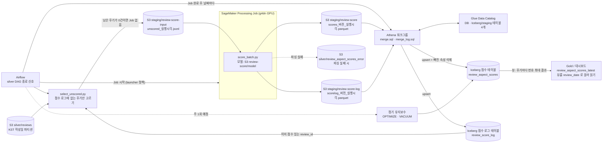

# athena-review-score stack (초안)

리뷰 점수 결과를 **Iceberg 테이블 + MERGE** 로 관리하기 위한 Athena/Glue 기반 (방식 D). 담당: lemin 이 작성하고, apply 는 인프라 담당(재영)이 plan 을 확인한 뒤 실행한다.
작업 지시서: [infra-athena-review-score.md](../../../docs/tasks/infra-athena-review-score.md). 모듈: [modules/athena-review-score](../../modules/athena-review-score/README.md).

- 선행: bootstrap(state 버킷), storage(데이터 버킷). 후행/연동: [sagemaker-review-score](../sagemaker-review-score/README.md) 의 출력 prefix 를 staging 으로 바꾸는 별도 변경이 필요하다.
- backend key: `clothes-query/dev/athena-review-score/terraform.tfstate`.
- 만드는 것(9개): **Gold 읽기용 Athena 뷰 `review_aspect_scores_latest`**, Glue 데이터베이스, **Iceberg 테이블 2개**(점수 `review_aspect_scores`, 후기별 점수 로그 `review_score_log`, 둘 다 파티션 `review_date`)와 **staging 외부 테이블 2개**(점수, 로그. Glue 테이블 리소스), Athena 워크그룹(엔진 v3, 결과 위치, 쿼리당 스캔 10GB 한도, 설정 강제), Airflow 용 IAM 정책 `athena_runner`(어떤 역할에도 자동으로 붙지 않음), 스크립트용 SSM 파라미터.
- 만들지 않는 것: 버킷·S3 수명주기(storage 소유), MERGE/OPTIMIZE/VACUUM 실행(Airflow), SageMaker 스택 변경.
- 비용: 만들어 두기만 하면 0. Athena 는 쿼리가 스캔한 데이터량 기준 과금(단가는 도쿄 리전 요금표 확인), 쿼리 결과·Iceberg 파일은 S3 저장 요금.

## 전체 흐름



- 파티션 날짜는 실행한 날이 아니라 **후기 작성일(KST)** 이다. 같은 날짜를 다시 실행하면 staging 에 새 파일이 쌓이고, `merge.sql` 이 `(review_id, aspect, model_version, review_date)` 별로 가장 최근 `analyzed_at` 만 남겨 upsert 한다.
- **다시 점수화했을 때 빠진 속성은 지운다**(2026-10-22 결정). 이번 배치에 들어온 후기에 대해서만, 새 결과에 없는 옛 속성 행을 `merge.sql` 이 삭제한다. 이번 배치에 없는 후기는 건드리지 않는다.
- **Gold 는 후기마다 `model_version_no` 가 가장 큰 결과를 읽는다**(`read_latest.sql`). **모델 번호 규칙** (`model_version_no`, "x.y" 형식 = decimal(4,1)): 평가 모델/로직이 바뀌면 메이저를 올리고(0.0→1.0), 작은 수정·버그 수정이면 마이너를 올린다(0.0→0.1). 마이너는 0~9 까지이고 x.9 다음 변경은 메이저를 올린다. 현재 `2.4b_score_s2c` = `1.0`. `model_version`(이름)과 1:1 이다.
- **매일 입력은 "아직 점수가 없는 후기"만**(2026-10-22 결정): `select_unscored.py` 가 Silver 하루 파일에서 점수 로그(`review_score_log`)에 이미 현재 `model_version_no` 로 기록된 후기를 빼고 남은 것만 Job 입력으로 쓴다. 0건이면 Job 을 띄우지 않는다. 모델 번호를 올리면 로그에 새 번호가 없어 모든 후기가 다시 선택된다(재점수화).
- 점수 로그가 필요한 이유: 속성이 0개 나온 후기는 점수 행이 없어서 점수 테이블만 보면 매일 "미점수"로 다시 잡힌다. 로그에는 그런 후기도 `n_aspects = 0` 으로 한 행 남는다. 파싱에 실패한 후기는 로그에 넣지 않아 다음 실행에서 다시 시도된다(계속 실패하면 오류 파일에 쌓인다).
- Bronze 로 시험할 때는 Silver 대신 `review-score/code/test-input/` 에 복사한 Bronze 파일을 입력으로 쓴다(Job 역할이 `silver/reviews/*` 와 미점수 입력 prefix 만 읽을 수 있어서).
- Airflow 연동(`Airflow` 에서 나가는 화살표)은 아직 구현 전이다. 지금은 `run_processing_job.py` 와 Athena 쿼리를 사람이 실행한다.

## 실행

공통 배포값(계정 ID, state 버킷)은 추적되는 `deployment.auto.tfvars.json`(자동 로드)과 `deployment.backend.hcl` 에 있다([DEPLOYMENT_CONFIG.md](../../DEPLOYMENT_CONFIG.md)).
이 스택은 개인 입력이 없다. 개인 값이 필요해지면 `deployment.local.tfvars.json`(Git 제외)에 JSON 으로 두고 plan 에 `-var-file` 로 지정한다.

```powershell
cd infra/stacks/athena-review-score
# AWS CLI 에 본인 계정(팀 계정)을 설정한 뒤

terraform init -backend=false -lockfile=readonly   # 정적 검사
terraform fmt -check
terraform validate

terraform init -backend-config=deployment.backend.hcl -lockfile=readonly
terraform plan -input=false -out=athena-review-score.tfplan
terraform apply athena-review-score.tfplan      # plan 을 확인한 담당자가 실행
```

(2026-10-22 이전 상태에서) 첫 plan 은 6 create 였다. 로그 테이블 2개를 추가한 변경은 기존 스택에 2 create / 3 change 로 나온다(다른 스택 리소스를 바꾸지 않음). destroy/replace 가 보이면 멈추고 확인한다.

## apply 후: 사용 순서

테이블(Iceberg, staging)은 **Terraform 이 만든다**(Glue 테이블 리소스의 `open_table_format_input`). [sql/](sql/) 에는 반영·유지보수·읽기용 쿼리 템플릿만 있다.
`{{자리표시자}}` 는 SSM 설정 파라미터(`config_parameter_name` output)의 값으로 채운다(버킷 이름을 저장소에 쓰지 않기 위해서).

| 순서 | 파일 | 실행 시점 | 자리표시자 |
|---|---|---|---|
| 0 | `migrate_add_model_version_no.sql` | **한 번만**(기존 점수 테이블에 `model_version_no` 열 추가, 값 1.0 채우기, 점수 로그 채우기) | `database`, `table`, `log_table`, `model_version`, `model_version_no` |
| 1 | `merge.sql` | 매일, Job 완료 후 날짜마다. upsert + 빠진 속성 삭제 | `database`, `table`, `staging_table`, `staging_log_table`, `year`, `month`, `day`, `model_version`, `model_version_no` |
| 2 | `merge_log.sql` | 매일, **`merge.sql` 뒤에**. 후기별 점수 로그 upsert | `database`, `log_table`, `staging_log_table`, `year`, `month`, `day`, `model_version`, `model_version_no` |
| 3 | `optimize.sql` | 정기(예: 주 1회) | `database`, `table`, `since` |
| 4 | `vacuum.sql` | 정기(OPTIMIZE 뒤) | `database`, `table` |
| - | `read_latest.sql` | 읽기 예시(하루치, 테이블 직접). Gold 는 뷰 `review_aspect_scores_latest` 를 쓴다 | `database`, `table`, `date` |

**apply 후 첫 적용 순서** (기존 테이블이 이미 있을 때): ① Terraform apply(로그 테이블 2개 생성, staging 열 추가) → ② `migrate_add_model_version_no.sql` 4문장을 하나씩 실행 → ③ 새 `score_batch.py` 를 S3 `review-score/code/` 에 업로드 → ④ Job 실행 → ⑤ `merge.sql` → `merge_log.sql`.
점수 테이블은 `ignore_changes` 라서 Terraform 이 새 열을 추가하지 않는다(그래서 ②가 필요). 로그 테이블은 새로 만들어지므로 처음부터 열이 있다.

모든 쿼리는 `workgroup` 으로 실행한다. 예(수동, 첫 확인용):

```powershell
$cfg = (aws ssm get-parameter --name /clothes-query/dev/athena-review-score/config --region ap-northeast-1 --query Parameter.Value --output text | ConvertFrom-Json)
# merge.sql 등의 자리표시자를 $cfg 값으로 바꿔 변수 $sql 에 담은 뒤:
aws athena start-query-execution --work-group $cfg.workgroup --query-string $sql --region ap-northeast-1
aws athena get-query-execution --query-execution-id <ID> --region ap-northeast-1 --query "QueryExecution.Status"
```

(Git Bash 에서는 SSM 이름 앞에 `MSYS_NO_PATHCONV=1` 이 필요하다.)

## Gold 가 읽는 방법: 뷰 `review_aspect_scores_latest`

Gold 는 점수 테이블이 아니라 **뷰**를 읽는다. 뷰가 "후기마다 `model_version_no` 가 가장 큰 결과(그 번호의 속성 전부)"를 돌려준다.
뷰 이름은 `latest_view_name` 변수(기본 `review_aspect_scores_latest`)이고 output `latest_view_name`·SSM 설정의 `latest_view` 로도 확인한다. 데이터베이스는 `clothes_query_dev_review_score`.

```sql
SELECT review_id, aspect, score, model_version, model_version_no, analyzed_at, review_date
FROM clothes_query_dev_review_score.review_aspect_scores_latest
WHERE review_date BETWEEN DATE '2026-10-01' AND DATE '2026-10-31';
```
- 열: `review_id, aspect, score(−2~+2), model_version(이름), model_version_no(번호 "x.y"), analyzed_at(UTC), review_date(후기 작성일 KST)`. 뷰를 만들 때 열 이름을 명시해서 점수 테이블의 열 순서(ADD COLUMNS 로 끝에 붙은 `model_version_no`)와 무관하다.
- **파티션 프루닝**: 뷰 정의에는 WHERE 가 없다. Gold 가 `review_date` 로 거르면 옵티마이저가 그 조건을 뷰 안으로 밀어 넣어 해당 날짜 파티션만 읽는다. 윈도우의 `PARTITION BY` 에 `review_id` 와 함께 `review_date` 를 넣었기 때문에 가능하다(후기 하나의 `review_date` 는 변하지 않아 결과는 같다). 실제로 밀리는지는 `EXPLAIN` 으로 확인한다(아래).
- 이 뷰는 읽기 전용이다. 쓰기(MERGE 등)는 점수 테이블에 한다.
- 권한: 뷰를 읽는 쪽(Gold)은 뷰와 점수 테이블에 대한 Glue 읽기, 점수 테이블 S3 prefix 읽기, Athena 워크그룹 사용 권한이 필요하다(Gold 의 역할은 이 스택 소관이 아니다).
- 뷰 정의 변경은 Terraform 으로 한다(`modules/athena-review-score/main.tf` 의 `latest_view_sql`). 콘솔에서 `CREATE OR REPLACE VIEW` 로 고치면 Terraform 과 어긋난다.
- **미검증**: Terraform 이 만든 뷰(`VIRTUAL_VIEW` + `Presto View` base64 JSON)를 Athena 가 정상 뷰로 읽는지, 파티션 프루닝이 되는지는 첫 apply 에서 확인한다. 안 되면 이 리소스를 빼고 Athena `CREATE OR REPLACE VIEW review_aspect_scores_latest AS <같은 SELECT>` 로 만든다.

**apply 후 확인 쿼리** (PowerShell, 앞서 정의한 `Run-Athena`/`Show` 사용)
```powershell
$VIEW = "$($A.database).$($A.latest_view)"
Show (Run-Athena "SELECT count(*) AS rows, count(DISTINCT review_id) AS reviews FROM $VIEW")                       # 점수 테이블과 같거나(버전이 하나뿐일 때) 적음
Show (Run-Athena "SELECT model_version_no, count(DISTINCT review_id) AS reviews FROM $VIEW GROUP BY 1")             # 후기마다 최대 번호만 남았는지(버전별 후기 수)
Show (Run-Athena "SELECT * FROM $VIEW WHERE review_date = DATE '2026-10-21' LIMIT 5")                              # 읽힘
# 파티션 프루닝 확인: 실행 계획에서 review_date 조건이 테이블 스캔까지 내려갔는지 본다
$q = Run-Athena "EXPLAIN SELECT * FROM $VIEW WHERE review_date = DATE '2026-10-21'"
Show $q
```
`EXPLAIN` 결과에서 `review_aspect_scores` 스캔 부분에 `review_date = DATE '2026-10-21'`(또는 constraint)가 보이면 프루닝된 것이다. `Show` 의 `$A.latest_view` 가 비어 있으면 `$A` 를 SSM 에서 다시 읽는다.

## SageMaker 스택과의 연결

`stacks/sagemaker-review-score` 의 `output_prefix` 는 이 스택의 `staging_prefix`(기본 `staging/review-score`)와 **같은 값**이어야 한다(2026-10-22 반영 완료). 다르면 Job 은 다른 곳에 쓰고 staging 테이블은 빈 채로 남는다.
Job 이 쓰는 Parquet 의 열(`review_id, aspect, score, model_version, model_version_no, analyzed_at, review_date`)과 staging 테이블의 열도 같아야 한다. 점수 로그도 같다: `sagemaker` 의 `score_log_prefix` = 이 스택의 `staging_log_prefix`, 열은 `review_id, model_version, model_version_no, analyzed_at, review_date, n_aspects`.
미점수 후기 입력(`unscored_input_prefix`, 기본 `staging/review-score-input`)은 `select_unscored.py` 를 실행하는 쪽이 쓰고 Job 역할이 읽는다.

## 결정한 것 (2026-10-22)

1. 다시 점수화했을 때 빠진 속성은 **삭제**한다 → `merge.sql` 의 tombstone 처리.
2. Gold 는 후기마다 **`model_version_no` 가 가장 큰 결과**를 읽는다 → `read_latest.sql`. 번호는 "x.y"(decimal(4,1)). 평가 모델/로직이 바뀌면 메이저를 올리고(0.0→1.0), 작은 수정·버그 수정이면 마이너를 올린다(0.0→0.1). 마이너는 0~9 까지이고 x.9 다음 변경은 메이저를 올린다. 현재 `2.4b_score_s2c` = `1.0`. `model_version`(이름)과 1:1 이다.
3. 매일 입력은 **아직 점수가 없는 후기만** → `select_unscored.py` + 점수 로그 테이블.

## 열린 질문 (결정 필요)

1. **staging 정리**: 반영이 끝난 staging 파일(점수, 로그, 미점수 입력)을 누가 지울지(Airflow 태스크 vs S3 수명주기). 수명주기는 버킷 소유 스택(storage)의 변경이라 이 스택에서 하지 않았다.
2. **Athena 결과 정리**: 쿼리마다 작은 결과 파일이 쌓인다. 같은 이유로 수명주기는 storage 스택에서 정해야 한다.
3. **계속 파싱에 실패하는 후기**: 로그에 넣지 않으므로 매일 다시 선택되어 Job 비용이 든다. 몇 번 실패하면 포기할지(재시도 한도)는 아직 없다.
4. **타임스탬프 타입**: `analyzed_at` 이 Parquet 의 UTC timestamp 인데 Athena Hive 테이블·Iceberg 의 `timestamp`(시간대 없음)로 읽힌다. 값이 맞는지 계속 확인한다.
5. **미검증 SQL**: `merge.sql` 의 ① `USING (WITH ...)` ② `WHEN MATCHED AND <조건>` / `WHEN NOT MATCHED AND <조건>` ③ 대상 테이블을 USING 쿼리에서 읽는 것은 Trino 문법 검사(sqlglot)는 통과했지만 실제 Athena 에서는 아직 실행해 보지 않았다. `decimal(4, 1)` 필드 타입이 Glue 의 Iceberg 테이블 생성에서 받아들여지는지도 apply 에서 확인한다.
6. **Airflow 실행 방식**: Athena 쿼리 시작/대기는 Airflow Operator(예: AthenaOperator) 사용 여부, 실패 시 재시도 정책.

## 삭제 및 운영 주의

- destroy 하면 Glue 테이블 정의는 지워지지만 Iceberg 의 S3 데이터·메타데이터 파일은 자동으로 지워지지 않는다(S3 에서 직접 정리).
- Athena 워크그룹은 쿼리 기록이 남아 있어 `force_destroy=false` 다. 지우려면 일부러 바꾼 뒤 apply 한다.
- 점수 스키마를 바꾸려면 Athena `ALTER TABLE` 을 쓴다. Terraform 은 `ignore_changes` 라서 스키마 변경을 적용하지 않는다.
