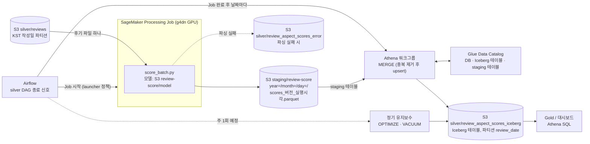

# athena-review-score stack (초안)

리뷰 점수 결과를 **Iceberg 테이블 + MERGE** 로 관리하기 위한 Athena/Glue 기반 (방식 D). 담당: lemin 이 작성하고, apply 는 인프라 담당(재영)이 plan 을 확인한 뒤 실행한다.
작업 지시서: [infra-athena-review-score.md](../../../docs/tasks/infra-athena-review-score.md). 모듈: [modules/athena-review-score](../../modules/athena-review-score/README.md).

- 선행: bootstrap(state 버킷), storage(데이터 버킷). 후행/연동: [sagemaker-review-score](../sagemaker-review-score/README.md) 의 출력 prefix 를 staging 으로 바꾸는 별도 변경이 필요하다.
- backend key: `clothes-query/dev/athena-review-score/terraform.tfstate`.
- 만드는 것(6개): Glue 데이터베이스, **Iceberg 테이블**(`review_aspect_scores`, 파티션 `review_date`)과 **staging 외부 테이블**(Glue 테이블 리소스), Athena 워크그룹(엔진 v3, 결과 위치, 쿼리당 스캔 10GB 한도, 설정 강제), Airflow 용 IAM 정책 `athena_runner`(어떤 역할에도 자동으로 붙지 않음), 스크립트용 SSM 파라미터.
- 만들지 않는 것: 버킷·S3 수명주기(storage 소유), MERGE/OPTIMIZE/VACUUM 실행(Airflow), SageMaker 스택 변경.
- 비용: 만들어 두기만 하면 0. Athena 는 쿼리가 스캔한 데이터량 기준 과금(단가는 도쿄 리전 요금표 확인), 쿼리 결과·Iceberg 파일은 S3 저장 요금.

## 전체 흐름



- 파티션 날짜는 실행한 날이 아니라 **후기 작성일(KST)** 이다. 같은 날짜를 다시 실행하면 staging 에 새 파일이 쌓이고, `merge.sql` 이 `(review_id, aspect, model_version, review_date)` 별로 가장 최근 `analyzed_at` 만 남겨 upsert 한다.
- Bronze 로 시험할 때는 Silver 대신 `review-score/code/test-input/` 에 복사한 Bronze 파일을 입력으로 쓴다(Job 역할이 `silver/reviews/*` 만 읽을 수 있어서).
- Airflow 연동(`Airflow` 에서 나가는 화살표)은 아직 구현 전이다. 지금은 `run_processing_job.py` 와 Athena 쿼리를 사람이 실행한다.

## 실행

공통 배포값(계정 ID, state 버킷)은 추적되는 `deployment.auto.tfvars.json`(자동 로드)과 `deployment.backend.hcl` 에 있다([DEPLOYMENT_CONFIG.md](../../DEPLOYMENT_CONFIG.md)).
이 스택은 개인 입력이 없다. 개인 값이 필요해지면 `deployment.local.tfvars.json`(Git 제외)에 JSON 으로 두고 plan 에 `-var-file` 로 지정한다.

```powershell
cd infra/stacks/athena-review-score
# AWS CLI 에 본인 계정(팀 계정)을 설정한 뒤

terraform init -backend=false -lockfile=readonly   # 정적 검사
terraform fmt -check
terraform validate

terraform init -backend-config=deployment.backend.hcl -lockfile=readonly
terraform plan -input=false -out=athena-review-score.tfplan
terraform apply athena-review-score.tfplan      # plan 을 확인한 담당자가 실행
```

첫 plan 은 6 create 여야 한다(다른 스택 리소스를 바꾸지 않음). destroy/replace 가 보이면 멈추고 확인한다.

## apply 후: 사용 순서

테이블(Iceberg, staging)은 **Terraform 이 만든다**(Glue 테이블 리소스의 `open_table_format_input`). [sql/](sql/) 에는 반영·유지보수·읽기용 쿼리 템플릿만 있다.
`{{자리표시자}}` 는 SSM 설정 파라미터(`config_parameter_name` output)의 값으로 채운다(버킷 이름을 저장소에 쓰지 않기 위해서).

| 순서 | 파일 | 실행 시점 | 자리표시자 |
|---|---|---|---|
| 1 | `merge.sql` | 매일, Job 완료 후 날짜마다 | `database`, `table`, `staging_table`, `year`, `month`, `day`, `model_version` |
| 2 | `optimize.sql` | 정기(예: 주 1회) | `database`, `table`, `since` |
| 3 | `vacuum.sql` | 정기(OPTIMIZE 뒤) | `database`, `table` |
| - | `read_latest.sql` | 읽기 예시 | `database`, `table`, `date` |

모든 쿼리는 `workgroup` 으로 실행한다. 예(수동, 첫 확인용):

```powershell
$cfg = (aws ssm get-parameter --name /clothes-query/dev/athena-review-score/config --region ap-northeast-1 --query Parameter.Value --output text | ConvertFrom-Json)
# merge.sql 등의 자리표시자를 $cfg 값으로 바꿔 변수 $sql 에 담은 뒤:
aws athena start-query-execution --work-group $cfg.workgroup --query-string $sql --region ap-northeast-1
aws athena get-query-execution --query-execution-id <ID> --region ap-northeast-1 --query "QueryExecution.Status"
```

(Git Bash 에서는 SSM 이름 앞에 `MSYS_NO_PATHCONV=1` 이 필요하다.)

## SageMaker 스택과의 연결

`stacks/sagemaker-review-score` 의 `output_prefix` 는 이 스택의 `staging_prefix`(기본 `staging/review-score`)와 **같은 값**이어야 한다(2026-10-22 반영 완료). 다르면 Job 은 다른 곳에 쓰고 staging 테이블은 빈 채로 남는다.
Job 이 쓰는 Parquet 의 열(`review_id, aspect, score, model_version, analyzed_at, review_date`)과 staging 테이블의 열도 같아야 한다.

## 열린 질문 (결정 필요)

1. **다시 점수화했더니 사라진 속성**: MERGE 는 원본에 없는 행을 지우지 않는다. 예전에 속성 X 가 있었는데 새 결과에는 없으면 옛 행이 남는다. 후기 단위로 지우고 다시 넣는 방식(DELETE + INSERT, 비원자적)을 쓸지 정해야 한다.
2. **staging 정리**: 반영이 끝난 staging 파일을 누가 지울지(Airflow 태스크 vs S3 수명주기). 수명주기는 버킷 소유 스택(storage)의 변경이라 이 스택에서 하지 않았다.
3. **Athena 결과 정리**: 쿼리마다 작은 결과 파일이 쌓인다. 같은 이유로 수명주기는 storage 스택에서 정해야 한다.
4. **Gold 의 버전 선택 규칙**: `read_latest.sql` 처럼 최신 버전만 읽을지, 특정 버전을 고정할지.
5. **타임스탬프 타입**: `analyzed_at` 이 Parquet 의 UTC timestamp 인데 Athena Hive 테이블·Iceberg 의 `timestamp`(시간대 없음)로 읽힌다. 첫 실행에서 값이 맞는지 확인해야 한다.
6. **검증 전 가정**: Terraform 이 만든 Iceberg 테이블(필드 id, 파티션 사양, `jsonencode` 한 타입)이 Athena 에서 정상으로 읽히고 `MERGE`/`OPTIMIZE`/`VACUUM` 이 되는지는 첫 apply 에서 확인해야 한다. `sql/*.sql` 도 실제 Athena 에서 실행해 보지 않았다.
   Glue 가 테이블 생성 뒤 값을 채워 diff 가 계속 보일 수 있어 `open_table_format_input`·`parameters` 는 `ignore_changes` 로 두었다(스키마 변경은 Athena `ALTER TABLE`).
   안 되면 테이블 리소스 2개를 Terraform 에서 빼고 Athena DDL(`CREATE TABLE ... TBLPROPERTIES ('table_type'='ICEBERG')` / 파티션 프로젝션 Hive 외부 테이블)로 만드는 방식으로 바꾼다.
7. **Airflow 실행 방식**: Athena 쿼리 시작/대기는 Airflow Operator(예: AthenaOperator) 사용 여부, 실패 시 재시도 정책.

## 삭제 및 운영 주의

- destroy 하면 Glue 테이블 정의는 지워지지만 Iceberg 의 S3 데이터·메타데이터 파일은 자동으로 지워지지 않는다(S3 에서 직접 정리).
- Athena 워크그룹은 쿼리 기록이 남아 있어 `force_destroy=false` 다. 지우려면 일부러 바꾼 뒤 apply 한다.
- 점수 스키마를 바꾸려면 Athena `ALTER TABLE` 을 쓴다. Terraform 은 `ignore_changes` 라서 스키마 변경을 적용하지 않는다.
